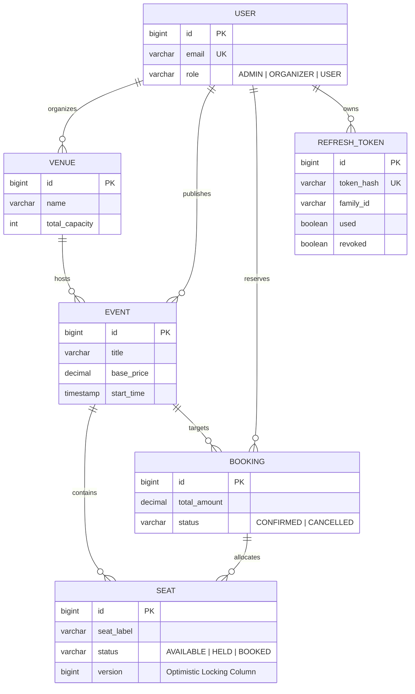

# QuickTix

A high-performance, concurrency-safe distributed live event ticketing and seat reservation platform built with [Java 25](https://openjdk.org/projects/jdk/25/), [Spring Boot 4](https://spring.io/projects/spring-boot), [PostgreSQL 16](https://www.postgresql.org/), [Redis 7](https://redis.io/), [Docker](https://www.docker.com/), and [React 19](https://react.dev/).

I built QuickTix to solve the high-concurrency ticket drop challenge: ensuring that when thousands of users attempt to reserve the exact same seats simultaneously, the system guarantees strict ACID consistency, sub-20ms catalog reads, and zero double-bookings without deadlocking database threads.

**Live Demo:** [https://quicktix-weld.vercel.app/](https://quicktix-weld.vercel.app/)  
**Interactive API Documentation:** [http://localhost:8080/swagger-ui.html](http://localhost:8080/swagger-ui.html)  
**Architecture & Engineering Handbook:** [architecture/](architecture/README.md)  
**Verification & Benchmark Scripts:** [scripts/](scripts/README.md)

---

## System Architecture

```
[ React 19 Client (Vite) ]
            │
            │ HTTPS (In-Memory Bearer JWT + HttpOnly Cookie)
            ▼
[ Spring Boot 4 Application Service ] (Port 8080)
   ├── Security Filter Chain: Stateless JwtAuthFilter & Centralized CORS
   ├── Web Layer: DTO validation via Jakarta @Valid & Swagger OpenAPI
   ├── WebSocket Broker: STOMP over /ws with SockJS fallback & /topic/event.{id}
   ├── Rate Limiting Layer: Bucket4j + Lettuce / Redis 7 (Anti-scalping bot shield)
   ├── Caching Layer: Redis Cache Manager (@Cacheable hot paths & @CacheEvict)
   ├── Business Layer: Atomic @Transactional reservations & ownership guards
   └── Persistence Layer: Hibernate 7 @Version Optimistic Locking
            │                              │
            │ Cache Reads & Token Buckets  │ JDBC Connection Pool (HikariCP)
            ▼                              ▼
[ Redis 7 In-Memory Store ]       [ PostgreSQL 16 Relational Database ]
(Port 6379, Docker named volume)   (Port 5432, Docker named volume)
```

---

## Domain Model



---

## Engineering Highlights & Technical Deep Dives

I documented each core subsystem in detail within the **[architecture/](architecture/README.md)** handbook:

* **[End-to-End Request Lifecycle](architecture/master-workflow.md)**: Full trace of requests from frontend click to database commit, with sequence diagrams for all primary lifecycles and failure mode resilience analysis.
* **[Concurrency Control & Optimistic Locking](architecture/concurrency-control.md)**: Hibernate `@Version` collision prevention, predicate-based SQL updates, and atomic batch rollbacks guaranteeing zero double-bookings.
* **[Distributed Caching Layer](architecture/distributed-caching.md)**: Sub-20ms catalog reads via Redis 7, deterministic `@CacheEvict` invalidation, 5-minute safety TTL, and fail-open `CacheErrorConfig`.
* **[Distributed Rate Limiting](architecture/distributed-rate-limiting.md)**: Bucket4j + Lettuce anti-scalping bot protection on `POST /api/bookings` with per-user (burst 5) and per-IP (burst 10) limits.
* **[Security & Dual-Token Auth](architecture/security-and-auth.md)**: In-memory 15-minute access tokens, Secure HttpOnly 7-day refresh cookies, SHA-256 database token hashing, and session family reuse detection.
* **[Real-Time Seat Synchronization](architecture/realtime-seat-sync.md)**: Full-duplex STOMP WebSocket broker on `/ws` broadcasting live seat status updates (`AVAILABLE`, `HELD`, `BOOKED`) to `/topic/event.{eventId}` without page refresh.
* **[Production Containerization](architecture/containerization.md)**: Multi-stage Alpine Docker build achieving a 50.1% container size reduction (from 870 MB down to 434 MB).
* **[Future Architectural Roadmap](architecture/future-roadmap.md)**: Blueprints for clustered Redis Pub/Sub brokers, Prometheus/Grafana metrics, automated CI/CD, and k6 load testing.
* **[Verification & Benchmark Scripts](scripts/README.md)**: Standalone test harnesses for concurrency collision testing (`race.mjs`), Redis latency benchmarking (`latency.mjs`), cache invalidation verification (`check-eviction.mjs`), and rate limit verification (`rate-limit.mjs`).

---

## Technology Stack

| Layer | Technology | Key Capabilities |
| :--- | :--- | :--- |
| **Backend Runtime** | Java 25 | LTS features, virtual thread readiness, modern syntax |
| **Backend Framework** | Spring Boot 4.0 | REST API, Spring Security, Spring Cache, Spring Data JPA |
| **Real-Time Messaging** | Spring WebSocket & STOMP | Full-duplex live seat status fan-out to connected attendees |
| **Distributed Store** | Redis 7 & Lettuce | Sub-millisecond catalog caching, atomic Bucket4j rate limiting |
| **Database Engine** | PostgreSQL 16 | ACID transactional persistence, relational integrity, indexes |
| **ORM & Concurrency** | Hibernate 7 | Predicate-level optimistic locking via `@Version` |
| **API Documentation** | springdoc-openapi 2.8 | OpenAPI 3.0 specification, interactive Swagger UI dashboard |
| **Containerization** | Docker & Compose | Optimized multi-stage build, healthcheck-driven service orchestration |
| **Frontend Client** | React 19 & Vite 6 | Fast HMR bundling, interactive venue seat picker, responsive design |
| **Client Real-Time** | @stomp/stompjs | WebSocket STOMP subscription on `/topic/event.{id}` |
| **Client Routing** | React Router 6 | Declarative role guards (`USER`, `ORGANIZER`, `ADMIN`) |
| **Client Auth & HTTP** | Axios Interceptors | In-memory token management, silent HttpOnly refresh queueing |

---

## Quick Start (Run with Docker Compose)

### 1. Clone & Configure
```bash
git clone https://github.com/asyncsourav/quicktix.git
cd quicktix
cp .env.example .env
```

### 2. Launch Stack
```bash
docker compose up -d --build
```
This single command:
1. Boots PostgreSQL 16 with health checks and persistent volume storage.
2. Boots Redis 7 with health checks and persistent volume storage.
3. Builds the Java 25 backend via multi-stage compilation and launches it on port `8080`.
4. Automatically seeds initial demo users, venues, and live events.

### 3. Launch Frontend Client
```bash
cd client
npm install
npm run dev
```
Open [http://localhost:5173](http://localhost:5173) in your browser.

---

## Demo Accounts

Pre-seeded accounts are immediately available for review with default password `password123`:

| Role | Email | Password | Access Scope |
| :--- | :--- | :--- | :--- |
| **Admin** | `admin@quicktix.com` | `password123` | Platform oversight, user management, revenue stats |
| **Organizer** | `organizer@quicktix.com` | `password123` | Venue registration, event publication |
| **Attendee (User)** | `user@quicktix.com` | `password123` | Event browsing, seat selection, booking creation |

> All 24 REST endpoints, request/response DTO schemas, and interactive test executions are available in Swagger UI at **[http://localhost:8080/swagger-ui.html](http://localhost:8080/swagger-ui.html)**.

---

## Author

**Sourav Kumar**
* **GitHub:** [https://github.com/asyncsourav](https://github.com/asyncsourav)
* **LinkedIn:** [https://www.linkedin.com/in/asyncsourav](https://www.linkedin.com/in/asyncsourav)
* **LeetCode:** [https://leetcode.com/u/asyncsourav](https://leetcode.com/u/asyncsourav)
* **Email:** [xsouravkumar357@gmail.com](mailto:xsouravkumar357@gmail.com)
