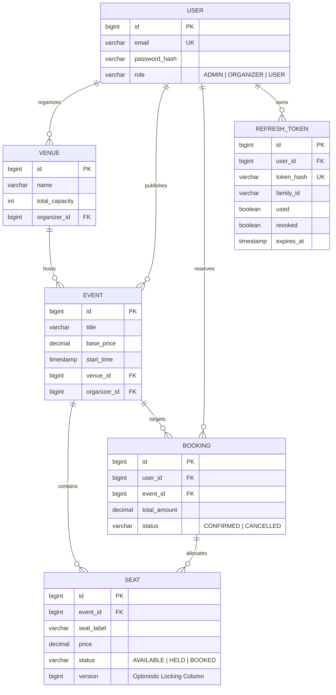

# QuickTix

A production-grade, distributed event ticketing and seat reservation platform built with [Java 25](https://openjdk.org/projects/jdk/25/), [Spring Boot 4](https://spring.io/projects/spring-boot), [PostgreSQL 16](https://www.postgresql.org/), [Docker](https://www.docker.com/), and [React 19](https://react.dev/).

QuickTix solves the classic high-concurrency ticket drop problem: ensuring that when thousands of users attempt to reserve the exact same seats simultaneously, the system guarantees strict consistency and zero double-bookings without sacrificing read throughput.

**Live Demo:** [https://quicktix-weld.vercel.app/](https://quicktix-weld.vercel.app/)  
**Interactive API Documentation:** [http://localhost:8080/swagger-ui.html](http://localhost:8080/swagger-ui.html)

<!-- SCREENSHOT: QuickTix Web Application Homepage and Event Catalog Banner -->

---

## System Architecture

QuickTix is designed as a decoupled, containerized client-server system with strict layer separation:

```
[ React 19 Client (Vite) ]
            │
            │ HTTPS / JSON (In-Memory Bearer JWT + HttpOnly Cookie)
            │
            ▼
[ Spring Boot 4 Application Service ] (Port 8080)
   │
   ├── Security Filter Chain
   │     ├── Stateless JwtAuthFilter (Bearer token validation)
   │     └── CORS Filter (Dynamic origins configured via application.yml)
   │
   ├── Web Layer (@RestController)
   │     └── DTO validation, REST responses (ApiResponse<T>, ErrorResponse)
   │
   ├── Caching Layer (Spring Data Redis / Lettuce)
   │     └── Redis Cache Manager (@Cacheable hot paths, @CacheEvict, 5-min TTL)
   │
   ├── Business Layer (@Service)
   │     ├── BookingService (Atomic @Transactional reservations)
   │     ├── AuthService (Dual-token rotation, HttpOnly cookie, reuse detection)
   │     └── Ownership Guards (Organizer resource validation)
   │
   └── Persistence Layer (Spring Data JPA / Hibernate 7)
         │
         └── Optimistic Concurrency Control (@Version check on Seat)
            │                              │
            │ Cache Reads & Invalidation   │ JDBC Connection Pool (HikariCP)
            │                              │
            ▼                              ▼
[ Redis 7 In-Memory Cache ]      [ PostgreSQL 16 Relational Database ]
(Port 6379, Docker named volume)  (Port 5432, Docker named volume)
```

---

## Domain Model & Data Architecture



---

## Core Engineering Highlights

### 1. Concurrency Control: Zero Double-Bookings

In high-demand ticket releases, multiple users click the same seat at the exact same millisecond. Simple application-level checks (`if (seat.isAvailable())`) fail under concurrency because both requests read `AVAILABLE` before either commits.

#### How QuickTix Solves It:
1. **Entity Versioning**: The `Seat` entity contains an internal `@Version private Long version;` column managed by Hibernate.
2. **Atomic Batch Reservation**: The booking method is enclosed in a database transaction (`@Transactional`).
3. **Database-Level Predicate**: When reserving Seat 3, the database issues:
   ```sql
   UPDATE seats 
   SET status = 'BOOKED', booking_id = 42, version = 2 
   WHERE id = 3 AND version = 1;
   ```
4. **Collision Detection**: The first thread to commit increments `version` to `2`. When the competing thread attempts to commit, `WHERE version = 1` matches zero rows.
5. **Immediate Rollback**: Hibernate detects zero affected rows and throws an `ObjectOptimisticLockingFailureException`. The Spring transaction manager rolls back the entire batch atomically.
6. **Unified Error Contract**: `GlobalExceptionHandler` intercepts the collision and returns HTTP 409 Conflict with a clear message: `"This seat was just selected or booked by another user."`

<!-- SCREENSHOT: Terminal output of concurrency race condition test showing 1 HTTP 201 winner and 9 HTTP 409 conflict rejections -->

#### Empirical Concurrency Benchmark (10 Simultaneous Requests)
Dispatching 10 parallel booking requests (`Promise.all`) for the exact same seat in the same event-loop tick produces deterministic isolation:

| Metric | Result |
| :--- | :--- |
| **Simultaneous Requests** | 10 requests dispatched within ~1 ms |
| **Successful Reservations** | **1 winner** (HTTP 201 Created) |
| **Rejected Collisions** | **9 rejections** (HTTP 409 Conflict) |
| **Database Consistency** | Exactly 1 booking created, seat status = `BOOKED`, version = `2` |

---

### 2. Security: Dual Token Rotation & Reuse Detection

QuickTix uses a **Dual-Token Architecture** with **Session Family Tracking** and **HttpOnly Cookie Storage** to prevent token theft, XSS exfiltration, and replay attacks:

```
[ User Login ] ───────────► Issues In-Memory Access Token (15m) + Sets HttpOnly Refresh Cookie (Family #1)
                                      │
[ Normal Rotation ] ──────► POST /api/auth/refresh (Cookie attached automatically)
                            ├── Previous Refresh Token marked USED in PostgreSQL
                            └── Issues new In-Memory Access Token + Rotated HttpOnly Cookie (Same Family #1)
                                      │
[ Compromise Detected ] ──► Attacker replays previous Refresh Token (ALREADY USED!)
                            ├── System detects REPLAY ATTACK via SHA-256 token hash lookup
                            ├── All tokens in Family #1 revoked immediately in PostgreSQL
                            └── Attacker and legitimate user sessions terminated (Cookie cleared with Max-Age=0)
```

1. **In-Memory Access Tokens (15 Minutes)**: Stateless JWTs verify identity and role permissions on every protected endpoint. Kept strictly in frontend memory (never written to `localStorage`), immunizing the application against cross-site scripting (XSS) token exfiltration.
2. **Secure HttpOnly Refresh Cookies (7 Days)**: Refresh tokens are transmitted as `HttpOnly`, `SameSite=Lax`, `Path=/api/auth` cookies. JavaScript cannot access them (`document.cookie` cannot read them).
3. **Opaque Hashed Records in PostgreSQL**: Refresh tokens are stored in the `refresh_tokens` table exclusively as **SHA-256 hashes** (`refresh_tokens.token_hash`). If the database is ever compromised, raw tokens cannot be derived.
4. **Automatic Token Rotation**: Each refresh request invalidates the submitted token (`used = true`) and issues a new dual pair within the same session `family_id`.
5. **Automated Breach Invalidation**: If an already-used or revoked token is presented, the server revokes **the entire token family** in PostgreSQL and instructs the browser to wipe the cookie.
6. **Centralized YAML CORS**: Allowed origins, allowed headers, and credential policies are fully driven by `application.yml` and the `CORS_ALLOWED_ORIGINS` environment variable, eliminating hardcoded URLs.
7. **Silent Client Refresh**: An Axios response interceptor in the React client catches HTTP 401, pauses outgoing requests in an in-memory queue, silently rotates the token pair with credentials, and seamlessly retries failed requests without interrupting the user.

---

### 3. Container Optimization: 50.1% Smaller Production Image

The backend uses a multi-stage [Dockerfile](server/Dockerfile) that separates the build environment from the production runtime:

```dockerfile
# Stage 1: Build stage (Maven + JDK 25)
FROM maven:3.9-eclipse-temurin-25-alpine AS build
WORKDIR /app
COPY pom.xml .
RUN mvn dependency:go-offline  # Dependency layer caching
COPY src ./src
RUN mvn clean package -DskipTests

# Stage 2: Minimal runtime stage (Alpine JRE 25 only)
FROM eclipse-temurin:25-jre-alpine
WORKDIR /app
COPY --from=build /app/target/*.jar app.jar
EXPOSE 8080
ENTRYPOINT ["java", "-jar", "app.jar"]
```

<!-- SCREENSHOT: Terminal output of 'docker images quicktix' comparing single-stage (870MB) vs multi-stage (434MB) -->

#### Measured Size Benchmark
```text
IMAGE             TAG      DISK USAGE   CONTENT SIZE
quicktix          single   870 MB       310 MB
quicktix          multi    434 MB       137 MB
```
* **Total Disk Reduction:** **50.11%** (436 MB eliminated)
* **Content Layer Reduction:** **55.81%** (173 MB eliminated)
* **Security Hardening:** The production container contains zero build tools (`javac`, Maven), zero source files, and zero package caches.

---

### 4. Distributed In-Memory Caching (Redis 7)

To handle viral ticket drop traffic spikes where thousands of users simultaneously load the event catalog, QuickTix integrates a distributed [Redis 7](https://redis.io/) caching layer:

1. **Declarative Spring Cache**:
   * `GET /api/events` is annotated with `@Cacheable(value = "events", key = "'all:' + #category + ':' + #search")`.
   * `GET /api/events/{id}` is annotated with `@Cacheable(value = "event", key = "#id")`.
2. **Deterministic Invalidation (`@CacheEvict`)**: Whenever an organizer or admin creates, updates, or deletes an event, `@CacheEvict(value = {"events", "event"}, allEntries = true)` clears the cached entries immediately, preventing stale read states.
3. **5-Minute Safety TTL**: Configured in [RedisConfig.java](server/src/main/java/com/asyncsourav/quicktix/config/RedisConfig.java) with `Duration.ofMinutes(5)` as a safety boundary for background expiry.

#### Empirical Read Latency Benchmark (1,000 Seeded Events)
Timing 200 sequential requests per endpoint (with 20 warm-up requests discarded) against the live containerized stack:

| Endpoint | Metric | Run A: No Cache (Postgres Only) | Run B: Redis 7 Cache | Improvement |
| :--- | :--- | :--- | :--- | :--- |
| **`GET /api/events`** (1,000 items) | Average Latency | **24.7 ms** | **18.4 ms** | **25.5% faster** |
| | p50 Median | **22.1 ms** | **17.7 ms** | **19.9% faster** |
| | p95 Latency | **38.9 ms** | **31.2 ms** | **19.8% faster** |
| **`GET /api/events/1`** (Detail view) | Average Latency | **15.2 ms** | **13.7 ms** | **10.5% faster** |
| | p50 Median | **15.3 ms** | **13.7 ms** | **10.5% faster** |
| | p95 Latency | **21.8 ms** | **20.4 ms** | **6.4% faster** |

---

## Technology Stack

| Layer | Technology | Purpose |
| :--- | :--- | :--- |
| **Backend Runtime** | [Java 25](https://openjdk.org/projects/jdk/25/) | Latest LTS language features, modern syntax |
| **Backend Framework** | [Spring Boot 4.0](https://spring.io/projects/spring-boot) | REST API, DI, auto-configuration |
| **Distributed Cache** | [Redis 7](https://redis.io/) / [Lettuce](https://lettuce.io/) | In-memory distributed caching for catalog read acceleration |
| **Data Persistence** | [Spring Data JPA](https://spring.io/projects/spring-data-jpa) / [Hibernate 7](https://hibernate.org/orm/) | ORM, query derivation, optimistic locking |
| **Database Engine** | [PostgreSQL 16](https://www.postgresql.org/) | ACID relational storage, constraints, indexes |
| **Security & Auth** | [Spring Security](https://spring.io/projects/spring-security) / [JJWT 0.12](https://github.com/jwtk/jjwt) | Stateless JWT filter chain, HttpOnly cookies, RBAC |
| **API Documentation** | [springdoc-openapi 2.8](https://springdoc.org/) | OpenAPI 3.0 specification, interactive Swagger UI |
| **Containerization** | [Docker](https://www.docker.com/) / [Docker Compose](https://docs.docker.com/compose/) | Multi-stage image build, service orchestration |
| **Frontend Framework** | [React 19](https://react.dev/) / [Vite 6](https://vitejs.dev/) | Component architecture, fast HMR bundling |
| **Client Routing** | [React Router 6](https://reactrouter.com/) | Protected routes, role-based navigation guards |
| **HTTP Interceptors** | [Axios](https://axios-http.com/) | In-memory bearer auth, silent cookie token refresh |
| **Styling & Theme** | Vanilla CSS Design Tokens | HSL color system, dark/light mode toggle |
| **Frontend Hosting** | [Vercel](https://vercel.com/) | Global edge delivery, SPA routing rewrites |

---

## Quick Start (Run Whole Stack)

### Prerequisites
* [Docker Desktop](https://www.docker.com/products/docker-desktop/) (running)
* [Node.js 18+](https://nodejs.org/) (for local client development)

### 1. Clone & Configure
```bash
git clone https://github.com/asyncsourav/quicktix.git
cd quicktix
cp .env.example .env
```

### 2. Start Full Backend, Database & Cache
```bash
docker compose up -d --build
```
This single command:
1. Starts PostgreSQL 16 with healthcheck and named volume persistence.
2. Starts Redis 7 with healthcheck and named volume persistence.
3. Compiles the Java 25 backend inside the multi-stage Docker builder.
4. Launches `quicktix-backend` on port `8080`.
5. Seeds 3 demo accounts, 3 venues, 4 events, and 120+ seats automatically.

Verify container status:
```bash
docker compose ps
```

### 3. Start Frontend Client
```bash
cd client
npm install
npm run dev
```
Open [http://localhost:5173](http://localhost:5173) in your browser.

---

## API Architecture

The backend exposes **24 REST endpoints** organized into 6 functional modules in Swagger UI:

| Module | Core Functionality | Primary Endpoints | Access Tier |
| :--- | :--- | :--- | :--- |
| **Auth** | Registration, dual-token login, token rotation, and family logout | `POST /api/auth/login`<br>`POST /api/auth/refresh`<br>`POST /api/auth/logout` | Public |
| **Events** | Event discovery, category & keyword filters, seat map status | `GET /api/events`<br>`GET /api/events/{id}/seats`<br>`POST /api/events` | Public (Read)<br>Organizer/Admin (Write) |
| **Venues** | Venue registration, capacity configuration, organizer listings | `GET /api/venues`<br>`POST /api/venues` | Public (Read)<br>Organizer/Admin (Write) |
| **Bookings** | Atomic multi-seat reservations with optimistic locking, cancellation | `POST /api/bookings`<br>`GET /api/bookings/me`<br>`DELETE /api/bookings/{id}` | Authenticated Users |
| **Admin** | Platform metrics, user directories, system-wide booking audit | `GET /api/admin/stats`<br>`GET /api/admin/users`<br>`GET /api/admin/bookings` | Admin Only |
| **Health** | Service liveness probe | `GET /api/ping` | Public |

> For complete interactive schemas, request/response DTOs, and one-click testing, visit **[http://localhost:8080/swagger-ui.html](http://localhost:8080/swagger-ui.html)**.

---

## Demo Credentials

When started on a fresh database, demo accounts are pre-seeded with password `password123`:

| Role | Email | Password | Intended Scope |
| :--- | :--- | :--- | :--- |
| **Admin** | `admin@quicktix.com` | `password123` | System oversight, metrics, user auditing |
| **Organizer** | `organizer@quicktix.com` | `password123` | Venue registration, event publication |
| **Attendee (User)** | `user@quicktix.com` | `password123` | Browsing, seat selection, booking creation |

---

## Engineering Roadmap

- [x] Phase 1: Core Domain Entities, JPA Repositories, REST API Endpoints
- [x] Phase 2: Role-Based Access Control (RBAC), Stateless JWT Security, BCrypt Hashing
- [x] Phase 3: Optimistic Locking Concurrency Control (`@Version`), Race Condition Verification
- [x] Phase 4: OpenAPI 3.0 / Swagger UI Interactive Documentation (`springdoc-openapi`)
- [x] Phase 5: Multi-Stage Docker Containerization, Full-Stack Docker Compose Orchestration
- [x] Phase 6: Dual rotating JWT refresh tokens with token family reuse detection & HttpOnly cookies
- [x] Phase 7: Distributed caching with Redis for hot read paths (event catalog, seat maps)
- [ ] Phase 8: Distributed API rate limiting via Bucket4j token bucket algorithms
- [ ] Phase 9: Real-time seat reservation broadcasts over WebSocket / STOMP protocol
- [ ] Phase 10: Automated test coverage (JUnit 5, Mockito, Testcontainers for PostgreSQL)
- [ ] Phase 11: Continuous Integration pipeline via GitHub Actions
- [ ] Phase 12: High-load performance testing via k6


---

## Author

**Sourav Kumar**
* **GitHub:** [https://github.com/asyncsourav](https://github.com/asyncsourav)
* **LinkedIn:** [https://www.linkedin.com/in/asyncsourav](https://www.linkedin.com/in/asyncsourav)
* **LeetCode:** [https://leetcode.com/u/asyncsourav](https://leetcode.com/u/asyncsourav)
* **Email:** [xsouravkumar357@gmail.com](mailto:xsouravkumar357@gmail.com)
