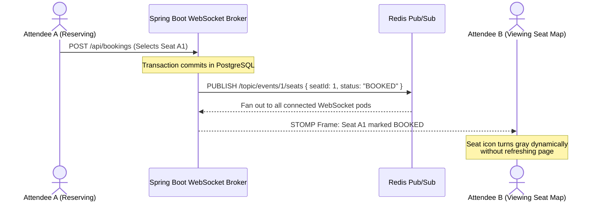

# My Engineering Roadmap & Future Architectural Extensions

This document outlines the architectural blueprints I am actively designing for the next phases of QuickTix, including real-time WebSocket seat map broadcasts, centralized telemetry, automated CI/CD pipelines, and distributed load testing.

---

## 1. Real-Time Seat Availability Broadcasts (WebSocket / STOMP)

Currently, seat maps load dynamically when navigating to an event detail page. My next milestone is replacing manual refreshes with full-duplex WebSocket connections so that seat status transitions broadcast live to all active attendees:



* **Why I Chose Redis Pub/Sub:** To support horizontal scaling across multiple Spring Boot instances, a booking processed on Pod 1 must broadcast to attendees connected to Pod 2. Redis Pub/Sub will act as the cross-pod message broker.
* **Authentication:** I plan to validate the existing in-memory JWT access token during the initial STOMP connection handshake.

---

## 2. Centralized Observability & Telemetry (Prometheus + Grafana)

To transition from container console logs to unified production telemetry, I am planning:

* **Structured JSON Logging:** Configure Logstash Logback encoder in Spring Boot to emit structured JSON logs containing `traceId`, `userId`, `clientIp`, `path`, and execution duration.
* **Metrics Export via Micrometer & Actuator:** Export live metrics to Prometheus:
  * HikariCP connection pool active/idle counts and connection acquisition wait times.
  * Redis cache hit, miss, and timeout ratios.
  * HTTP 429 rate limit throttle rates by client IP and user.
  * HTTP 409 optimistic locking collision rates per event.
* **Grafana Dashboards:** Visual tracking of p95 and p99 API latencies and request throughput.

---

## 3. Automated CI/CD Pipeline (GitHub Actions)

I am designing an automated continuous integration and deployment pipeline:

```
[ Push to main / PR ]
         │
         ▼
[ Stage 1: Build & Unit Test ]
  - Run JDK 25 Maven build
  - Execute JUnit 5 & Mockito test suite
         │
         ▼
[ Stage 2: Integration Tests (Testcontainers) ]
  - Spin up disposable PostgreSQL 16 & Redis 7 containers
  - Verify optimistic locking and rate limiting integration
         │
         ▼
[ Stage 3: Container Build & Vulnerability Scan ]
  - Build multi-stage Docker image
  - Run Trivy vulnerability scan on production JRE layer
         │
         ▼
[ Stage 4: Production Deployment ]
  - Push image to container registry
  - Trigger rolling update on production cluster
```

---

## 4. Distributed High-Load Testing (k6 / Gatling)

Following my Node.js benchmark scripts ([scripts/race.mjs](../scripts/race.mjs), [scripts/latency.mjs](../scripts/latency.mjs)), I am setting up distributed k6 load testing scenarios:

* **Scenario 1: Scalper Bot Flood**
  * 1,000 virtual users hammering `POST /api/bookings` concurrently.
  * Target Metric: My Bucket4j + Redis rate limiter throttles 95%+ of bot requests with HTTP 429 within 200ms, preserving database connection health.
* **Scenario 2: Viral Ticket Drop Contention**
  * 500 concurrent requests competing for the exact same 50 available seats.
  * Target Metric: Exactly 50 bookings succeed (HTTP 201); 450 requests receive HTTP 409 Conflict; zero double-booking collisions occur in PostgreSQL.
