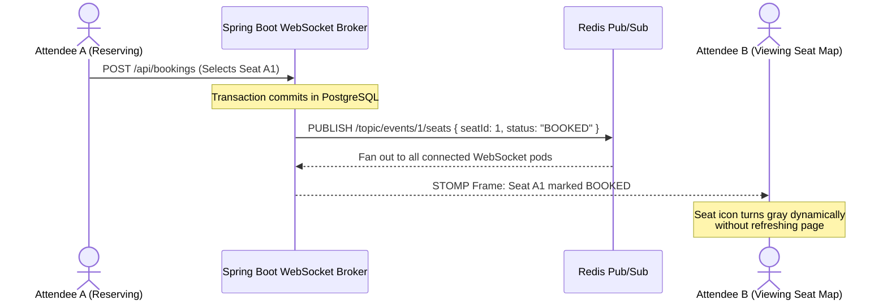

# Future Architectural Extensions & Roadmap

This document outlines the architectural blueprints for upcoming platform extensions, including WebSocket live seat maps, centralized logging, CI/CD pipelines, and distributed load testing.

---

## 1. Real-Time Seat Availability Broadcasts (WebSocket / STOMP)

Currently, seat maps are refreshed on page load and polling. The target architecture integrates full duplex WebSocket connections to broadcast seat status transitions in real time.



* **Redis Pub/Sub Layer**: Enables horizontal scaling across multiple backend instances so that a booking processed on Instance 1 immediately broadcasts to WebSocket clients connected to Instance 2.
* **Client Handshake**: Authenticated via STOMP headers using the existing JWT access token.

---

## 2. Centralized Observability & Logging (ELK / Loki + Grafana)

To transition from localized container logs to unified production monitoring:

* **Structured JSON Logging**: Spring Boot configured with Logstash Logback encoder to format application logs in structured JSON (including `traceId`, `userId`, `clientIp`, `uri`, and execution latency).
* **Metrics Export**: Spring Boot Actuator + Micrometer exporting metrics to Prometheus:
  * HikariCP connection pool usage and wait times.
  * Redis cache hit/miss ratios.
  * Rate limit rejection counters (HTTP 429 count by route).
  * Optimistic locking collision rates (HTTP 409 count by event).
* **Grafana Dashboards**: Real-time visual tracking of p95/p99 API latencies and system throughput.

---

## 3. Automated CI/CD Pipeline (GitHub Actions)

Target automated workflow for continuous integration and zero-downtime deployment:

```
[ Push to main / PR ]
         │
         ▼
[ Stage 1: Build & Unit Test ]
  - Run JDK 25 Maven build
  - Execute JUnit 5 & Mockito test suite
         │
         ▼
[ Stage 2: Integration Tests (Testcontainers) ]
  - Spin up disposable PostgreSQL 16 & Redis 7 containers
  - Verify optimistic locking and rate limiting integration
         │
         ▼
[ Stage 3: Container Build & Vulnerability Scan ]
  - Build multi-stage Docker image
  - Trivy vulnerability scanning on production JRE layer
         │
         ▼
[ Stage 4: Production Deployment ]
  - Push image to registry
  - Trigger rolling update on production cluster
```

---

## 4. Distributed High-Load Testing (k6 / Gatling)

Architectural benchmark harness to stress-test concurrent booking spikes:

* **Test Scenario 1: The Scalper Bot Flood**
  * 1,000 virtual users hitting `POST /api/bookings` concurrently.
  * Verification: Bucket4j + Redis rate limits throttle 95%+ of bot requests with HTTP 429 within 200ms without database exhaustion.
* **Test Scenario 2: Viral Ticket Drop Race Condition**
  * 500 concurrent requests targeting the same 50 available seats.
  * Verification: Exactly 50 bookings succeed (HTTP 201); remaining requests receive HTTP 409; zero double-booking collisions.
