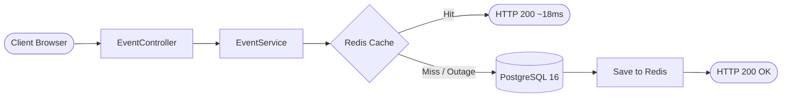
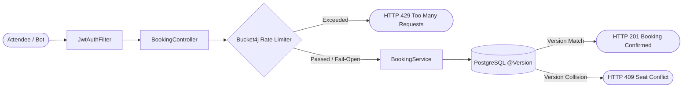
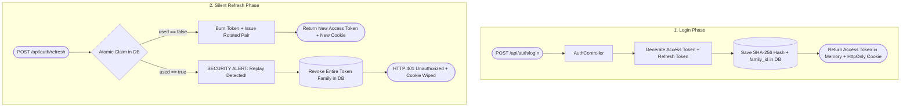

# Master Request Lifecycle & System Pipeline

This document defines the high-level request pipeline for QuickTix, tracing how incoming HTTP requests traverse the security layer, input validation, distributed rate limiting, business services, distributed caching, and database concurrency controls.

Detailed architectural specifications, code deep dives, and benchmark logs for each individual subsystem are organized in their respective dedicated documentation files.

---

## High-Level Request Pipeline

I structured the platform around strict architectural boundaries. Each cross-cutting concern is evaluated in sequential stages before requests reach database persistence:

```
[ Browser / Frontend Client ]
             │
             │ HTTPS (In-Memory Bearer Token + HttpOnly Cookie)
             ▼
[ 1. Spring Security Filter Chain ]
     ├── CorsFilter (Dynamic YAML origin verification via CorsProperties)
     └── JwtAuthFilter (Stateless Bearer JWT validation & UserDetails extraction)
             │
             ▼
[ 2. Web Layer & Validation ]
     ├── DTO Binding & Validation (@Valid Jakarta constraints)
     └── Client IP Extraction (X-Forwarded-For, X-Real-IP, RemoteAddr)
             │
             ▼
[ 3. Anti-Scalping Rate Limiter (Bucket4j + Redis 7) ]
     ├── Per-IP Limit Check (rate:booking:ip:{clientIp})
     ├── Per-User Limit Check (rate:booking:user:{username})
     └── Fail-Open Try/Catch Guard (Bypasses limiter if Redis is unavailable)
             │
             ▼
[ 4. Service Layer ]
     ├── Business Logic Orchestration (@Transactional boundaries)
     └── Ownership & Role Verification (User, Organizer, Admin)
             │
             ▼
[ 5. Distributed Caching Layer (Redis 7) ]
     ├── Cache Lookup (@Cacheable hot paths in Redis)
     │     ├── Cache Hit: Return cached JSON immediately (< 20ms)
     │     ├── Cache Miss: Proceed to database query
     │     └── Cache Error: Fail-open fallback via CacheErrorConfig
     └── Cache Eviction (@CacheEvict purges stale catalog keys on updates)
             │
             ▼
[ 6. Persistence & Concurrency Control (PostgreSQL 16) ]
     ├── Optimistic Locking: Hibernate @Version check on Seat (WHERE id=? AND version=?)
     ├── ACID Commit: Commit booking or trigger atomic batch rollback on collision
     └── Database Integrity: Relational foreign keys and unique constraints
             │
             ▼
[ 7. Response Dispatch ]
     ├── HTTP 200 / 201: ApiResponse<T> JSON envelope
     ├── HTTP 409: Seat conflict (ObjectOptimisticLockingFailureException)
     └── HTTP 429: Rate limit exceeded (Retry-After header attached)
```

---

## Workflow 1: Live Event Catalog Read Flow (`GET /api/events`)

The high-level path for browsing and searching live events:



1. **Client Request:** The attendee requests the catalog with optional search or category filters.
2. **Security & Web Layer:** Public endpoint (`permitAll`), validates query parameters.
3. **Service Layer:** `EventService.getAllEvents()` is invoked.
4. **Caching Layer:** Checks Redis using composite key `events::all:{category}:{search}`:
   * **Cache Hit:** Returns serialized JSON in under 20ms, completely bypassing PostgreSQL.
   * **Cache Miss:** Queries PostgreSQL, stores the result in Redis with a 5-minute TTL, and returns HTTP 200.
   * **Redis Outage:** `CacheErrorConfig` intercepts the timeout, treats it as a miss, and falls back directly to PostgreSQL with zero downtime.

> **Dedicated Deep Dive:** For complete cache configuration, TTL invalidation, the `CacheErrorConfig` outage fix, and 200-run latency benchmarks, see **[Distributed Caching Architecture](distributed-caching.md)**.

---

## Workflow 2: Ticket Booking & Concurrency Flow (`POST /api/bookings`)

The high-level path for reserving seats under concurrent traffic:



1. **Authentication:** `JwtAuthFilter` validates the in-memory Bearer access token and extracts the authenticated user.
2. **Rate Limiting Edge Filter:** `RateLimiterService` checks Redis token buckets (IP burst 10, User burst 5):
   * If capacity is exceeded: Throws `RateLimitExceededException` -> returns HTTP 429 with `Retry-After`.
   * If Redis is down: Fails open within 200ms and allows the request through to PostgreSQL.
3. **Transactional Booking Execution:** `BookingService` executes inside `@Transactional`.
4. **Optimistic Locking Verification:** Hibernate issues `UPDATE seats ... WHERE id = ? AND version = ?`:
   * **Winner Thread:** 1 row updated -> version increments -> booking created -> HTTP 201 Created.
   * **Loser Thread:** 0 rows updated -> `ObjectOptimisticLockingFailureException` -> atomic batch rollback -> HTTP 409 Conflict.

> **Dedicated Deep Dives:**
> * For anti-scalping bot models, Bucket4j token bucket algorithms, and fail-open design, see **[Distributed Rate Limiting](distributed-rate-limiting.md)**.
> * For optimistic locking SQL predicates, atomic batch rollbacks, and `race.mjs` test verification, see **[Concurrency Control & Double-Booking Prevention](concurrency-control.md)**.

---

## Workflow 3: Dual-Token Authentication & Rotation Flow (`/api/auth/*`)

The high-level path for session issuance, silent rotation, and replay attack defense:



1. **Login & Issuance:** User authenticates. The server returns a 15-minute access token in JSON (stored in memory) and sets a 7-day refresh token in a Secure, `HttpOnly` cookie. Only the SHA-256 hash is saved in PostgreSQL under a unique `family_id`.
2. **Silent Rotation:** When the access token expires, the client's Axios interceptor automatically posts the cookie. The database executes an atomic claim (`UPDATE refresh_tokens SET used = true WHERE id = ? AND used = false`). A new token pair is issued under the same family.
3. **Replay Detection:** If an attacker presents an already-used token, the system detects `used == true`. Using `@Transactional(noRollbackFor = BadCredentialsException.class)`, it immediately commits a revocation of the entire token family in PostgreSQL, wipes the cookie, and aborts the session.

> **Dedicated Deep Dive:** For complete token lifecycle analysis, XSS defenses, the transaction rollback bug fix, and atomic claim queries, see **[Security & Dual-Token Authentication](security-and-auth.md)**.
