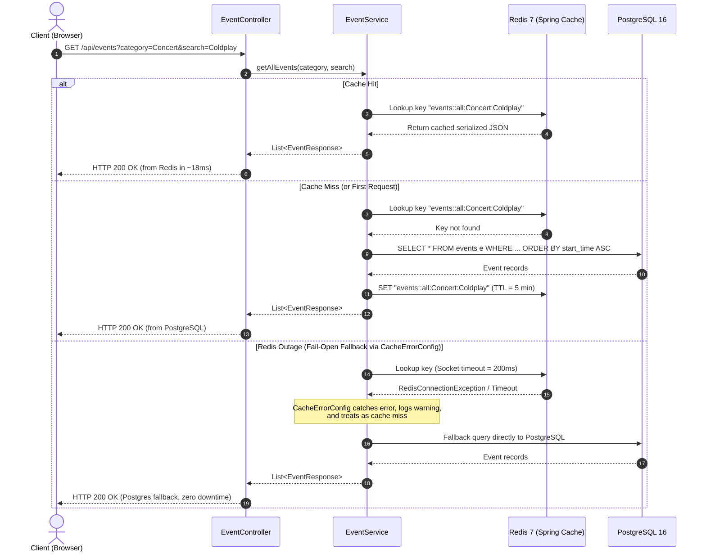
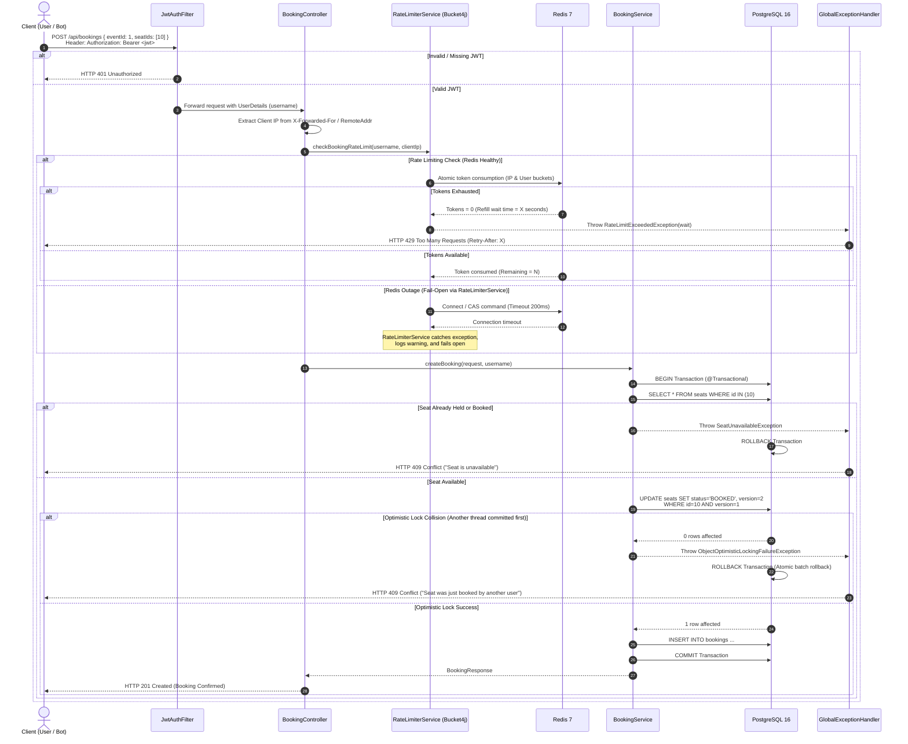
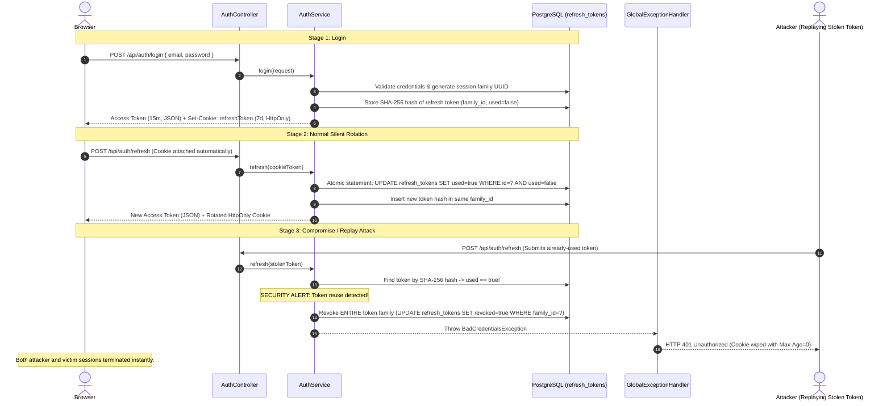

# End-to-End System Architecture & Request Lifecycle

This document provides a comprehensive trace of how I architected QuickTix's request lifecycle across the frontend, security filters, rate limiters, caching layers, business logic, and transactional database persistence.

---

## High-Level Request Pipeline

I structured the platform around clear architectural boundaries so that cross-cutting concerns (security, anti-scalping limits, caching) are handled before requests reach heavy database transactions:

```
[ Browser / Frontend Client ]
             │
             │ HTTPS (In-Memory Bearer Token + HttpOnly Cookie)
             ▼
[ 1. Spring Security Filter Chain ]
     ├── CorsFilter (Dynamic YAML origin verification via CorsProperties)
     └── JwtAuthFilter (Stateless Bearer JWT validation & UserDetails extraction)
             │
             ▼
[ 2. Web Layer & Validation ]
     ├── DTO Binding & Validation (@Valid Jakarta constraints)
     └── Client IP Extraction (X-Forwarded-For, X-Real-IP, RemoteAddr)
             │
             ▼
[ 3. Anti-Scalping Rate Limiter (Bucket4j + Redis 7) ]
     ├── Per-IP Limit Check (rate:booking:ip:{clientIp})
     ├── Per-User Limit Check (rate:booking:user:{username})
     └── Fail-Open Try/Catch Guard (Bypasses limiter if Redis is unavailable)
             │
             ▼
[ 4. Service & Caching Layer ]
     ├── Catalog Reads: Spring Cache (@Cacheable hot paths in Redis)
     │     └── CacheErrorConfig (Falls back to PostgreSQL if Redis times out)
     └── Writes / Bookings: @Transactional boundaries
             │
             ▼
[ 5. Persistence & Concurrency Control ]
     ├── Optimistic Locking: Hibernate @Version check on Seat
     ├── PostgreSQL 16: ACID commit with unique constraints
     └── Cache Invalidation: @CacheEvict purges stale catalog entries
             │
             ▼
[ 6. Response Dispatch ]
     ├── HTTP 200 / 201: ApiResponse<T> JSON envelope
     ├── HTTP 409: Seat conflict (ObjectOptimisticLockingFailureException)
     └── HTTP 429: Rate limit exceeded (Retry-After header attached)
```

---

## Detailed Lifecycle 1: How I Optimized Catalog Reads (`GET /api/events`)

Because browsing accounts for over 90% of traffic, I designed the catalog path to serve responses directly from Redis memory in under 20ms, while ensuring that a Redis outage never causes HTTP 500 errors:



---

## Detailed Lifecycle 2: How I Engineered Seat Reservations (`POST /api/bookings`)

The booking endpoint is the most mission-critical pipeline in the system. I engineered it to enforce dual-tier bot rate limiting at the controller boundary, followed by Hibernate `@Version` optimistic locking in PostgreSQL:



---

## Detailed Lifecycle 3: How I Designed Token Rotation & Replay Detection

To defend user accounts against token theft and replay attacks without maintaining server session state, I designed rotating refresh tokens with session family tracking in PostgreSQL:



---

## Detailed Lifecycle 4: How I Handled Cache Invalidation on Event Updates

When an organizer or administrator modifies event metadata, I ensure stale data never lingers in Redis by executing deterministic cache eviction:

```
Organizer / Admin: PUT /api/events/{id} or DELETE /api/events/{id}
       │
       ▼
1. Security Filter Chain: Verifies role is ORGANIZER or ADMIN.
2. Ownership Guard: Verifies organizer owns the event (or user is ADMIN).
3. EventService (@Transactional):
   - Updates or deletes record in PostgreSQL.
   - Triggers Spring Cache directive:
     @CacheEvict(value = {"events", "event"}, allEntries = true)
4. Redis 7:
   - Evicts all cached catalog and event detail keys immediately.
5. Response:
   - Returns updated EventResponse (HTTP 200) or No Content (HTTP 204).
6. Next Client Read:
   - Receives fresh data from PostgreSQL and repopulates the Redis cache.
```

---

## How I Engineered Resilience Across Failure Modes

| Component | Failure Condition | How I Engineered the System Response | User Experience |
| :--- | :--- | :--- | :--- |
| **Redis 7** | Cache offline / timeout | `CacheErrorConfig` catches timeout (200ms) and falls back to PostgreSQL | Catalog queries succeed (HTTP 200) with zero downtime |
| **Redis 7** | Limiter offline / timeout | `RateLimiterService` fails open and delegates safety to PostgreSQL | Bookings succeed (HTTP 201); optimistic locking protects data |
| **PostgreSQL** | Concurrent seat clash | Hibernate `@Version` mismatch rolls back transaction atomically | Loser receives HTTP 409 Conflict with re-selection prompt |
| **Auth JWT** | Access token expired | Axios interceptor pauses queue and calls `/api/auth/refresh` | Experience is seamless; token refreshed silently in background |
| **Refresh Token**| Token replayed / stolen | `AuthService` revokes all family tokens with `noRollbackFor` commit | Both sessions terminated; credentials protected from replay |
