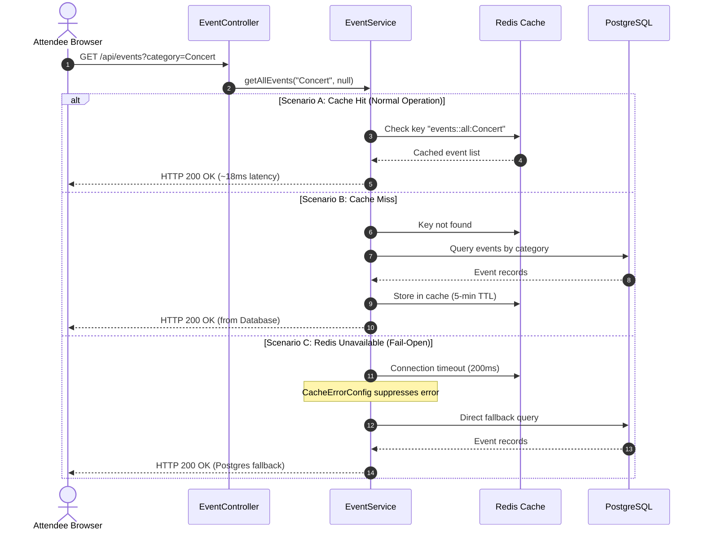
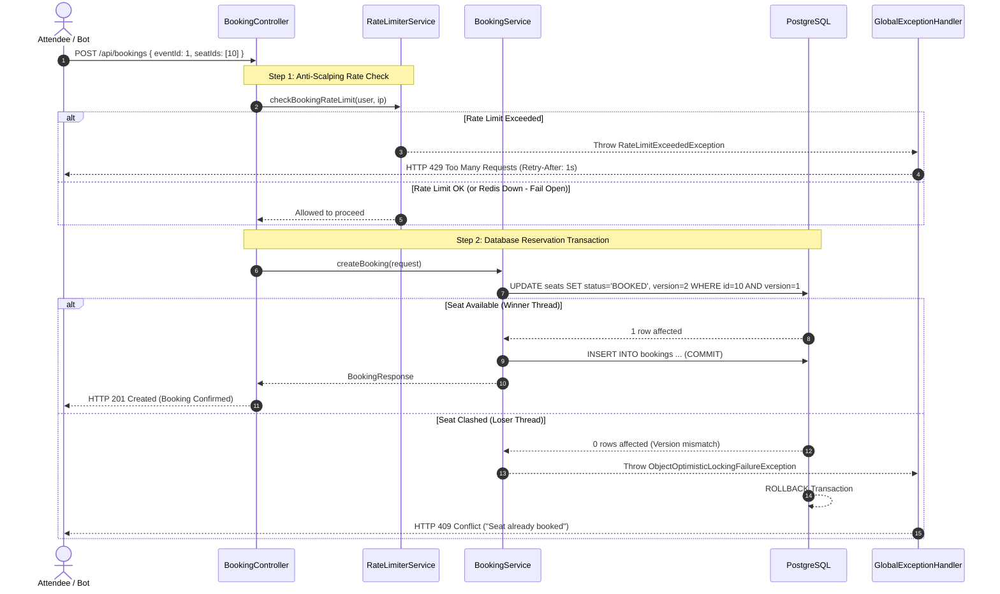
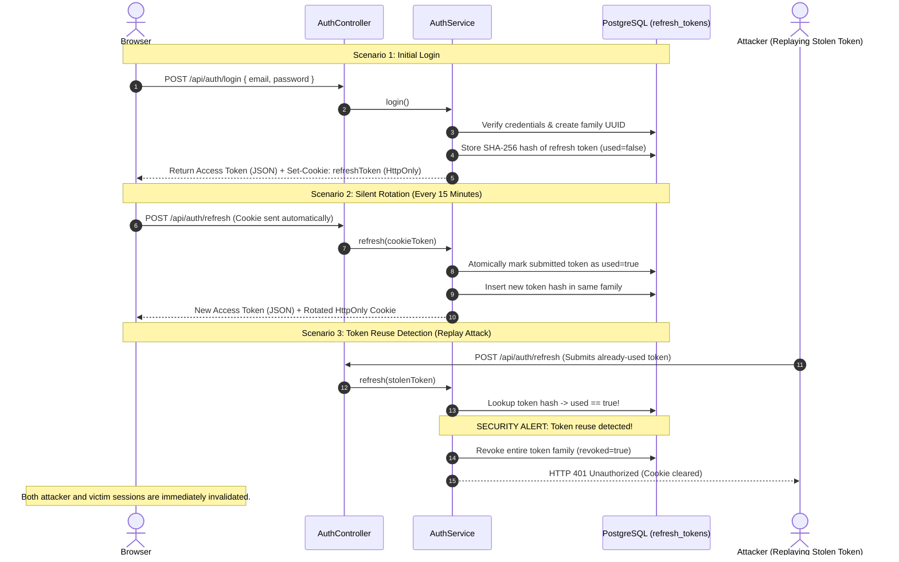

# System Workflows & Request Lifecycle

This document provides a clear, step-by-step walkthrough of how requests move through QuickTix. It breaks down the system into four primary workflows: catalog browsing, ticket reservations, session authentication, and cache invalidation.

---

## 1. High-Level Request Pipeline

Every incoming HTTP request travels through a predictable, multi-tier pipeline:

```
[ Frontend Client (React 19) ]
              │
              ▼ (HTTPS with Bearer Token & HttpOnly Cookie)
[ Tier 1: Security & Identity ]
  - CorsFilter: Validates allowed origins from application.yml
  - JwtAuthFilter: Parses Bearer JWT, validates signature, sets SecurityContext
              │
              ▼
[ Tier 2: Validation & Rate Limiting ]
  - Controller DTO Validation: Jakarta @Valid checks input shape
  - Bucket4j Token Bucket: Checks per-IP and per-user limits in Redis
              │
              ▼
[ Tier 3: Service & Caching ]
  - Hot Reads (Catalog): Served from Redis 7 cache (< 20ms)
  - Fail-Open Protection: Falls back to PostgreSQL if Redis times out
              │
              ▼
[ Tier 4: Database & Concurrency ]
  - Write Transactions: Spring @Transactional boundary
  - Optimistic Locking: Hibernate @Version check prevents double-booking
  - Cache Invalidation: @CacheEvict purges stale Redis keys
```

---

## 2. Workflow 1: Catalog Browsing (`GET /api/events`)

### Purpose
Deliver fast event catalog queries (sub-20ms) while protecting PostgreSQL from high read volume during ticket drop traffic spikes.

### Execution Flow
1. **Client Request**: Attendee loads the catalog page or filters events by category/keyword.
2. **Cache Check**: `EventService` checks Redis for the cache key (e.g., `events::all:Concert:Coldplay`).
3. **Branch A — Cache Hit**: Redis returns the cached JSON list in ~18ms. PostgreSQL is never touched.
4. **Branch B — Cache Miss**: On the first request, the database runs the query, returns the events, and saves the serialized result to Redis with a 5-minute TTL.
5. **Branch C — Redis Outage (Fail-Open)**: If Redis is down or unreachable, `CacheErrorConfig` catches the socket timeout (200ms), logs a warning, and queries PostgreSQL directly. The endpoint returns HTTP 200 without downtime.

### Sequence Diagram



---

## 3. Workflow 2: Ticket Reservation (`POST /api/bookings`)

### Purpose
Guarantee that seats can never be double-booked under concurrent traffic spikes, while throttling automated bot scripts before they can exhaust database connections.

### Two-Phase Execution Architecture

#### Phase 1: Rate Limiting & Bot Shield (Redis Layer)
* Before touching the database, the request enters `RateLimiterService`.
* Checks the client IP bucket (capacity: 10 tokens, refill: 2/sec) and the user bucket (capacity: 5 tokens, refill: 1/sec).
* If tokens are exhausted, the server rejects the request immediately with **HTTP 429 Too Many Requests** and a `Retry-After` header.
* If Redis is unreachable, the limiter **fails open** and allows the request through to PostgreSQL.

#### Phase 2: Transactional Reservation & Version Check (PostgreSQL Layer)
* Inside a `@Transactional` boundary, `BookingService` reads the selected seats.
* Hibernate executes an atomic update query with a version predicate:
  ```sql
  UPDATE seats SET status = 'BOOKED', version = version + 1
  WHERE id = ? AND version = ?;
  ```
* **Winner Thread**: Matches `version = 1`, increments to `2`, updates 1 row, and commits the booking (**HTTP 201 Created**).
* **Loser Thread**: Attempts update `WHERE version = 1`, but the row is already at version `2`. Exactly 0 rows update. Hibernate throws `ObjectOptimisticLockingFailureException`. The transaction rolls back cleanly, and the client receives **HTTP 409 Conflict**.

### Sequence Diagram



---

## 4. Workflow 3: Dual-Token Authentication & Replay Protection

### Purpose
Maintain long-lived user sessions without exposing sensitive tokens to browser storage (`localStorage`), while detecting and revoking compromised sessions automatically.

### Token Strategy Summary
* **Access Token**: Short-lived (15 minutes), kept only in frontend JavaScript memory. Passed in the `Authorization: Bearer` header.
* **Refresh Token**: Long-lived (7 days), stored in a `Secure`, `HttpOnly`, `SameSite=Lax` cookie. Accessible only by the browser network stack.
* **Database Tracking**: Only SHA-256 hashes are stored in PostgreSQL (`refresh_tokens` table) grouped by a `family_id` UUID.

### The Three Authentication Scenarios



---

## 5. Workflow 4: Event Updates & Cache Invalidation (`PUT /api/events/{id}`)

### Purpose
Ensure that when an organizer edits event details or cancels a show, attendees immediately see the updated information without waiting for TTL expiration.

### Execution Flow
1. **Authorization**: `SecurityConfig` verifies that the caller has `ORGANIZER` or `ADMIN` authority.
2. **Ownership Check**: `EventService` verifies that the authenticated user owns the target event (or is a platform administrator).
3. **Database Write**: Event details are updated in PostgreSQL within a Spring `@Transactional` context.
4. **Cache Purge (`@CacheEvict`)**: Spring Cache automatically executes the eviction directive:
   ```java
   @CacheEvict(value = {"events", "event"}, allEntries = true)
   ```
   Redis immediately purges all keys in the `events` and `event` cache namespaces.
5. **Next Read**: The very next catalog or event query fetches fresh data from PostgreSQL and transparently repopulates the Redis cache.

---

## 6. System Resilience & Error Translation Matrix

The table below summarizes how each tier responds to runtime failures, ensuring predictable error handling across the platform:

| Failure Scenario | Trigger | System Reaction | HTTP Response to Client |
| :--- | :--- | :--- | :--- |
| **Concurrent Seat Clash** | Two users book same seat | Hibernate `@Version` check matches 0 rows; transaction rolled back | **HTTP 409 Conflict**<br/>"This seat was just selected by another user" |
| **Rate Limit Exceeded** | Scalper bot sends burst > 5/sec | Bucket4j consumes all available tokens in Redis | **HTTP 429 Too Many Requests**<br/>Includes `Retry-After: 1` header |
| **Redis Cache Down** | Redis container stopped | `CacheErrorConfig` catches socket timeout (200ms) and queries DB | **HTTP 200 OK**<br/>Zero downtime; catalog served from PostgreSQL |
| **Redis Limiter Down** | Redis container stopped | `RateLimiterService` catches connection error and fails open | **HTTP 201 Created**<br/>Bookings proceed; Postgres handles concurrency |
| **Expired Access Token** | 15 minutes elapsed | Axios client catches 401 and calls `/api/auth/refresh` | **Transparent**<br/>New access token issued silently via cookie |
| **Stolen Refresh Token** | Attacker replays burned token | `AuthService` detects `used = true` on existing hash | **HTTP 401 Unauthorized**<br/>Entire token family revoked; cookie wiped |
