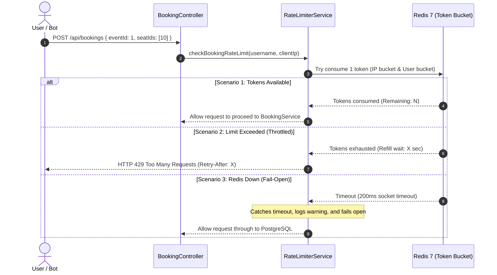
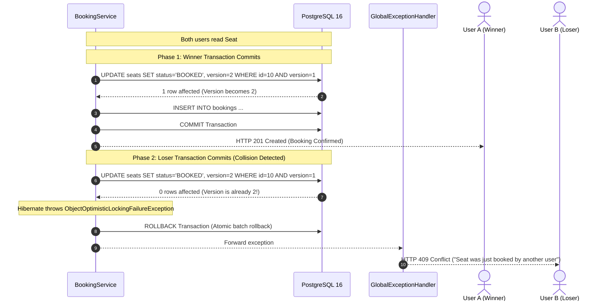

# End-to-End System Architecture & Request Lifecycle

This document provides a comprehensive, visual walkthrough of how I architected QuickTix's primary request workflows across the frontend, security filters, rate limiters, caching layers, business logic, and transactional database persistence.

---

## High-Level Request Pipeline

I structured the platform around clear architectural boundaries so that cross-cutting concerns (security, anti-scalping limits, caching) are handled before requests reach heavy database transactions:

```
[ Browser / Frontend Client ]
             │
             │ HTTPS (In-Memory Bearer Token + HttpOnly Cookie)
             ▼
[ 1. Spring Security Filter Chain ]
     ├── CorsFilter (Dynamic YAML origin verification via CorsProperties)
     └── JwtAuthFilter (Stateless Bearer JWT validation & UserDetails extraction)
             │
             ▼
[ 2. Web Layer & Validation ]
     ├── DTO Binding & Validation (@Valid Jakarta constraints)
     └── Client IP Extraction (X-Forwarded-For, X-Real-IP, RemoteAddr)
             │
             ▼
[ 3. Anti-Scalping Rate Limiter (Bucket4j + Redis 7) ]
     ├── Per-IP Limit Check (rate:booking:ip:{clientIp})
     ├── Per-User Limit Check (rate:booking:user:{username})
     └── Fail-Open Try/Catch Guard (Bypasses limiter if Redis is unavailable)
             │
             ▼
[ 4. Service & Caching Layer ]
     ├── Catalog Reads: Spring Cache (@Cacheable hot paths in Redis)
     │     └── CacheErrorConfig (Falls back to PostgreSQL if Redis times out)
     └── Writes / Bookings: @Transactional boundaries
             │
             ▼
[ 5. Persistence & Concurrency Control ]
     ├── Optimistic Locking: Hibernate @Version check on Seat
     ├── PostgreSQL 16: ACID commit with unique constraints
     └── Cache Invalidation: @CacheEvict purges stale catalog entries
             │
             ▼
[ 6. Response Dispatch ]
     ├── HTTP 200 / 201: ApiResponse<T> JSON envelope
     ├── HTTP 409: Seat conflict (ObjectOptimisticLockingFailureException)
     └── HTTP 429: Rate limit exceeded (Retry-After header attached)
```

---

## Workflow 1: Live Event Catalog & Distributed Caching (`GET /api/events`)

### Purpose
Event browsing accounts for more than 90% of total application traffic. I designed this workflow to serve catalog requests directly from Redis memory in under 20ms while guaranteeing that a Redis outage never causes HTTP 500 errors.

### Visual Architecture


### The 3 Execution Scenarios

1. **Cache Hit (The Fast Path):**
   * The client requests the catalog with optional search or category parameters.
   * `EventService` looks up the composite key `events::all:{category}:{search}` in Redis 7.
   * Redis returns the cached JSON in **~18ms**, completely bypassing PostgreSQL.

2. **Cache Miss (First Request or Expired TTL):**
   * If the key does not exist in Redis, the service queries PostgreSQL.
   * Spring Cache stores the result in Redis with a 5-minute time-to-live (`Duration.ofMinutes(5)`).
   * Returns **HTTP 200 OK** to the client.

3. **Redis Outage (Fail-Open Resilience):**
   * If Redis crashes or experiences network partitions, Spring Cache would normally throw an unhandled `QueryTimeoutException` (HTTP 500).
   * My [`CacheErrorConfig.java`](../server/src/main/java/com/asyncsourav/quicktix/config/CacheErrorConfig.java) intercepts the error, logs a warning, and treats it as a simple cache miss.
   * The application queries PostgreSQL directly, returning **HTTP 200 OK** with zero downtime for attendees.

---

## Workflow 2: Ticket Booking & Concurrency Control (`POST /api/bookings`)

### Purpose
The booking reservation endpoint is the most mission-critical pipeline in QuickTix. It protects the platform against two distinct failure modes:
1. **Edge Abuse:** Automated scalper bots exhausting database connection pool threads with parallel spam.
2. **Database Over-Selling:** Multiple concurrent attendees attempting to book the exact same seat simultaneously.

I designed this workflow as a two-stage pipeline:

---

### Stage A: Anti-Scalping Edge Limiter (Bucket4j + Redis)

Before any database connection is opened, the request must pass through my dual-tier distributed rate limiter:



* **Per-IP Limit:** Capacity 10 tokens, refill 2 tokens/sec (blocks unauthenticated bot clusters).
* **Per-User Limit:** Capacity 5 tokens, refill 1 token/sec (blocks authenticated single-account automation scripts).
* **Fail-Open Design:** If Redis fails, the limiter allows requests through because PostgreSQL optimistic locking guarantees business correctness.

---

### Stage B: Concurrency Control in PostgreSQL (Optimistic Locking)

Once the request clears the rate limiter, [`BookingService.java`](../server/src/main/java/com/asyncsourav/quicktix/service/BookingService.java) executes inside a Spring `@Transactional` boundary.

Here is what happens when **User A (Winner)** and **User B (Loser)** attempt to reserve the same seat (`id = 10, version = 1`) at the exact same millisecond:



* **Why Zero Double-Bookings Occur:** The database update requires `WHERE version = 1`. Because User A's commit incremented the version to `2`, User B's update affects `0` rows.
* **Atomic Batch Safety:** If an attendee reserves multiple seats (e.g. Seats 10, 11, 12) and even one seat experiences a collision, the entire transaction rolls back atomically. Zero partial reservations are ever saved.

---

## Workflow 3: Dual-Token Auth, Silent Rotation & Replay Defense

### Purpose
To protect user sessions against XSS token theft, session hijacking, and replay attacks without using server-side session state.

I structured this lifecycle into three clean phases:

---

### Phase 1: Login & Token Issuance

When an attendee logs in, the server generates an in-memory access token and an HttpOnly refresh cookie:

```
Client (Browser)                   Server (AuthController)                 Database (PostgreSQL)
     │                                       │                                       │
     ├─── POST /api/auth/login ─────────────►│                                       │
     │    { email, password }                │                                       │
     │                                       ├── Validate credentials                │
     │                                       ├── Generate unique session family UUID │
     │                                       ├── SHA-256 hash raw refresh token ────►│ Store hash record
     │                                       │                                       │ (family_id, used=false)
     │◄── HTTP 200 OK ───────────────────────┤                                       │
     │    1. JSON Body: Access Token (15m)   │                                       │
     │    2. Cookie: refreshToken (7d,       │                                       │
     │       HttpOnly, Secure, SameSite=Lax) │                                       │
```

* **Access Token:** 15-minute lifespan, stored only in frontend memory (never in `localStorage` or `sessionStorage`), eliminating XSS token theft.
* **Refresh Token:** 7-day lifespan, sent in a Secure, `HttpOnly` cookie inaccessible to browser JavaScript.
* **Database Hash:** Only the SHA-256 digest is stored in PostgreSQL. If the database is ever breached, raw refresh tokens cannot be reconstructed.

---

### Phase 2: Silent Rotation (The Safe Refresh)

When the 15-minute access token expires, the client's Axios interceptor transparently sends `POST /api/auth/refresh`:

```
Client (Browser)                   Server (AuthService)                    Database (PostgreSQL)
     │                                       │                                       │
     ├─── POST /api/auth/refresh ───────────►│                                       │
     │    (HttpOnly cookie sent by browser)  ├── Atomic Token Claim:                 │
     │                                       │   UPDATE refresh_tokens               │
     │                                       │   SET used=true                       │
     │                                       │   WHERE id=? AND used=false ─────────►│ 1 row affected
     │                                       │                                       │ (Current token burned)
     │                                       ├── Generate new token pair             │
     │                                       │   under same family UUID ────────────►│ Insert new token hash
     │                                       │                                       │
     │◄── HTTP 200 OK ───────────────────────┤                                       │
     │    New Access Token + Rotated Cookie  │                                       │
```

* **Atomic Claim:** The SQL statement `UPDATE refresh_tokens SET used = true WHERE id = ? AND used = false` atomically marks the token as used. If two concurrent requests arrive simultaneously with the same token, only one can succeed, preventing session family splitting.

---

### Phase 3: Token Replay Attack (The Security Trap)

If an attacker intercepts an old, already-used refresh token and attempts to refresh the session:

```
Attacker                           Server (AuthService)                    Database (PostgreSQL)
     │                                       │                                       │
     ├─── POST /api/auth/refresh ───────────►│                                       │
     │    (Replaying stolen refresh token)   ├── SHA-256 hash lookup in DB           │
     │                                       │   Token found, but used == true!      │
     │                                       │                                       │
     │                                       │   SECURITY ALERT: REPLAY DETECTED!    │
     │                                       │                                       │
     │                                       ├── Revoke entire family:               │
     │                                       │   UPDATE refresh_tokens               │
     │                                       │   SET revoked=true                    │
     │                                       │   WHERE family_id=? ─────────────────►│ All family tokens revoked!
     │                                       │                                       │
     │◄── HTTP 401 Unauthorized ─────────────┤                                       │
     │    Set-Cookie: refreshToken;          │                                       │
     │    Max-Age=0 (Wipes browser cookie)   │                                       │
```

* **The Rollback Fix:** In [`AuthService.java`](../server/src/main/java/com/asyncsourav/quicktix/service/AuthService.java), I annotated `refresh()` with `@Transactional(noRollbackFor = BadCredentialsException.class)`. This ensures that even when the method throws an exception to reject the attacker, the family revocation is committed to PostgreSQL. Both the attacker and the victim sessions are instantly terminated.

---

## Workflow 4: Cache Invalidation on Event Updates (`PUT /api/events/{id}`)

When an organizer or administrator modifies event metadata, stale catalog keys in Redis are purged immediately:

```
Organizer / Admin: PUT /api/events/{id}
       │
       ▼
1. Security Check: Verify caller has role ORGANIZER or ADMIN.
2. Ownership Guard: Verify organizer owns the event (or user is ADMIN).
3. EventService (@Transactional):
   - Updates record in PostgreSQL.
   - Triggers Spring Cache directive:
     @CacheEvict(value = {"events", "event"}, allEntries = true)
4. Redis 7:
   - Evicts all cached catalog and event detail keys immediately.
5. Next Client Read:
   - Queries PostgreSQL, receives fresh data, and repopulates Redis.
```

---

## Failure Modes & System Resilience Matrix

| Component | Failure Condition | How I Engineered the System Response | User Experience |
| :--- | :--- | :--- | :--- |
| **Redis 7** | Cache offline / timeout | `CacheErrorConfig` catches 200ms timeout and falls back to PostgreSQL | Catalog queries succeed (HTTP 200) with zero downtime |
| **Redis 7** | Limiter offline / timeout | `RateLimiterService` fails open and delegates safety to PostgreSQL | Bookings succeed (HTTP 201); optimistic locking protects data |
| **PostgreSQL** | Concurrent seat clash | Hibernate `@Version` mismatch triggers atomic batch rollback | Loser receives HTTP 409 Conflict with seat re-selection prompt |
| **Auth JWT** | Access token expired | Axios interceptor pauses queue and calls `/api/auth/refresh` | Experience is seamless; token refreshed silently in background |
| **Refresh Token**| Token replayed / stolen | `AuthService` revokes all family tokens with `noRollbackFor` commit | Both sessions terminated; credentials protected from replay |
