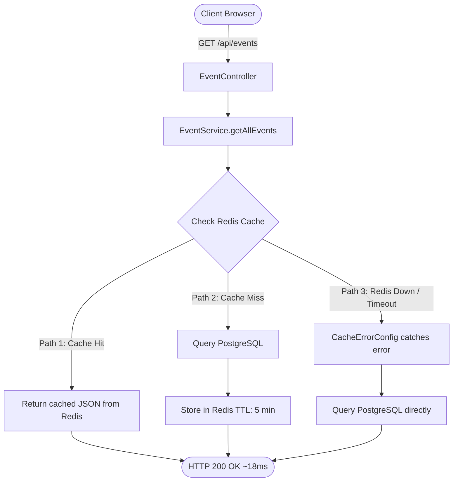
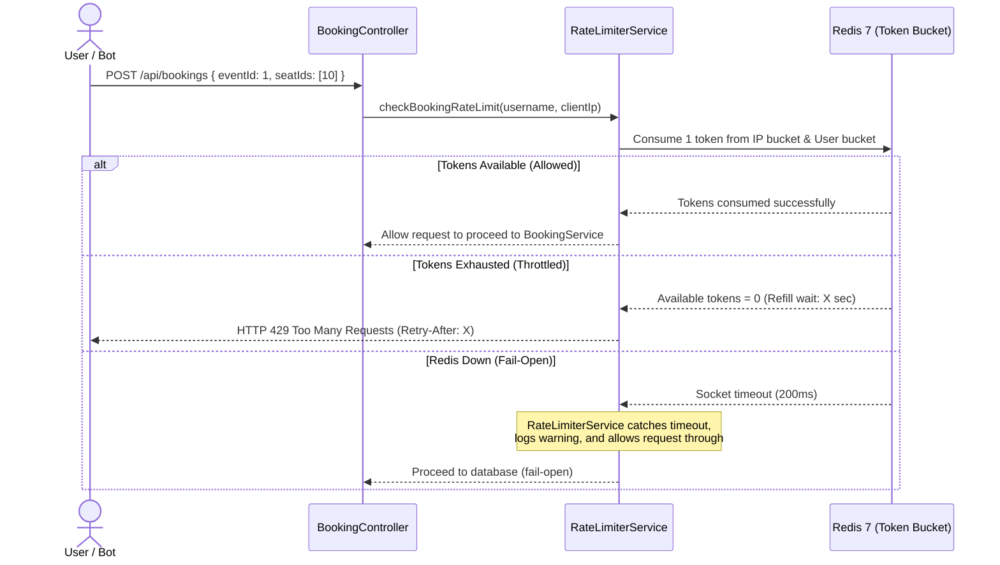
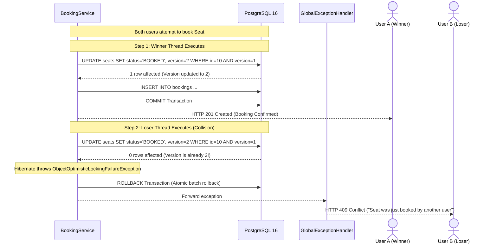

# End-to-End System Architecture & Request Lifecycle

This document provides a clean, visual walkthrough of how I designed QuickTix's primary request workflows. 

Rather than showing cluttered, deeply nested sequence diagrams that are hard to read, this guide breaks each lifecycle into simple, digestible stages with clear separation between the **Happy Path** and **Resilience Edge Cases**.

---

## 1. Event Catalog Read & Caching Workflow (`GET /api/events`)

### Purpose
Event browsing accounts for over 90% of platform traffic. I designed this path to serve catalog queries directly from Redis in under 20ms while guaranteeing that a Redis outage never causes HTTP 500 errors.

### The 3 Execution Paths



### How Each Path Works

#### Path 1: Cache Hit (Fast Path)
1. The client requests the event list with optional category/search filters.
2. `EventService` checks Redis using a composite key: `events::all:{category}:{search}`.
3. Redis returns the cached JSON in **~18ms**, completely bypassing PostgreSQL.

#### Path 2: Cache Miss (First Request)
1. The key is not found in Redis.
2. The service queries PostgreSQL, returning active events sorted by start time.
3. Spring Cache stores the result in Redis with a 5-minute TTL and returns **HTTP 200 OK**.

#### Path 3: Redis Outage (Fail-Open Fallback)
1. If Redis crashes or network latency exceeds 200ms, Spring Cache would normally throw an exception and return **HTTP 500**.
2. To prevent this, my [`CacheErrorConfig.java`](../server/src/main/java/com/asyncsourav/quicktix/config/CacheErrorConfig.java) intercepts the error, logs a warning, and treats the error as a cache miss.
3. The query falls back directly to PostgreSQL and returns **HTTP 200 OK** with zero downtime.

---

## 2. Ticket Booking & Concurrency Control (`POST /api/bookings`)

### Purpose
The booking pipeline is the core of the platform. It must handle two distinct threats:
1. **At the edge:** Stop automated scalper bots before they waste database connection pool threads.
2. **At the database:** Guarantee that two concurrent users can never double-book the exact same seat.

I decoupled this into two clear, independent stages:

---

### Stage A: Rate Limiter Edge Defense (Bucket4j + Redis)

Before any database connection is acquired, the request must pass through my dual-tier token bucket rate limiter:



* **IP Bucket:** Capacity 10 tokens, refills 2 tokens/sec (blocks unauthenticated bot spam).
* **User Bucket:** Capacity 5 tokens, refills 1 token/sec (blocks authenticated automated checkout scripts).
* **Fail-Open Policy:** If Redis is down, the request passes through to PostgreSQL where optimistic locking guarantees data correctness.

---

### Stage B: Concurrency Control in PostgreSQL (Optimistic Locking)

Once the request passes the rate limiter, [`BookingService.java`](../server/src/main/java/com/asyncsourav/quicktix/service/BookingService.java) executes inside a Spring `@Transactional` boundary:



* **Why It Never Double-Books:** The SQL `WHERE id = ? AND version = ?` predicate guarantees that only the first committing transaction succeeds. 
* **Atomic Batch Safety:** If an attendee reserves 4 seats and even 1 seat collides, Spring rolls back all 4 seats atomically. Zero partial bookings occur.

---

## 3. Dual-Token Authentication & Replay Protection

### Purpose
To protect user sessions from XSS token theft, session hijacking, and replay attacks without using stateful server sessions.

I organized this into three distinct, easy-to-follow phases:

---

### Phase 1: Login & Token Issuance

```
Client (User)                      Server (AuthController)                 Database (PostgreSQL)
     │                                       │                                       │
     ├─── POST /api/auth/login ─────────────►│                                       │
     │    { email, password }                │                                       │
     │                                       ├── Validate credentials                │
     │                                       ├── Generate family UUID                │
     │                                       ├── SHA-256 hash refresh token ────────►│ Store hash
     │                                       │                                       │ (family_id, used=false)
     │◄── HTTP 200 OK ───────────────────────┤                                       │
     │    1. JSON Body: Access Token (15m)   │                                       │
     │    2. Cookie: refreshToken (7d,       │                                       │
     │       HttpOnly, Secure, SameSite=Lax) │                                       │
```

* **Access Token:** 15-minute lifespan, stored only in frontend JavaScript memory (never in `localStorage`).
* **Refresh Token:** 7-day lifespan, sent in an `HttpOnly` cookie inaccessible to browser JavaScript.
* **Database Record:** Only the SHA-256 digest is stored, protecting credentials against database dumps.

---

### Phase 2: Silent Rotation (The Safe Refresh)

When the 15-minute access token expires, the client's Axios interceptor transparently requests a refresh:

```
Client (Browser)                   Server (AuthService)                    Database (PostgreSQL)
     │                                       │                                       │
     ├─── POST /api/auth/refresh ───────────►│                                       │
     │    (Cookie sent automatically)        ├── Atomic Claim:                       │
     │                                       │   UPDATE refresh_tokens               │
     │                                       │   SET used=true                       │
     │                                       │   WHERE id=? AND used=false ─────────►│ 1 row affected
     │                                       │                                       │ (Token burned)
     │                                       ├── Generate new token pair             │
     │                                       │   in same family UUID ───────────────►│ Insert new hash
     │                                       │                                       │
     │◄── HTTP 200 OK ───────────────────────┤                                       │
     │    New Access Token + Rotated Cookie  │                                       │
```

* **Atomic Claim:** The single SQL update `UPDATE ... SET used=true WHERE id=? AND used=false` prevents simultaneous refreshes from generating split session families.

---

### Phase 3: Token Replay Attack (The Security Trap)

If an attacker steals a previously used refresh token and attempts to replay it:

```
Attacker                           Server (AuthService)                    Database (PostgreSQL)
     │                                       │                                       │
     ├─── POST /api/auth/refresh ───────────►│                                       │
     │    (Replaying stolen token)           ├── Hash lookup: token found            │
     │                                       │   but used == true!                   │
     │                                       │                                       │
     │                                       │   SECURITY ALERT: REPLAY DETECTED!    │
     │                                       │                                       │
     │                                       ├── Revoke entire family:               │
     │                                       │   UPDATE refresh_tokens               │
     │                                       │   SET revoked=true                    │
     │                                       │   WHERE family_id=? ─────────────────►│ All tokens revoked!
     │                                       │                                       │
     │◄── HTTP 401 Unauthorized ─────────────┤                                       │
     │    Set-Cookie: refreshToken;          │                                       │
     │    Max-Age=0 (Cookie wiped)           │                                       │
```

* **The Rollback Fix:** Because I annotated `refresh()` with `@Transactional(noRollbackFor = BadCredentialsException.class)`, the family revocation commits to PostgreSQL before throwing the 401 exception. Both the attacker and the victim are logged out immediately, neutralizing the stolen session.

---

## 4. Cache Invalidation on Event Updates (`PUT /api/events/{id}`)

When an organizer or administrator updates an event, stale cache entries in Redis are purged immediately:

```
Organizer / Admin: PUT /api/events/{id}
       │
       ▼
1. Security Check: Verify role is ORGANIZER or ADMIN.
2. Ownership Guard: Verify organizer owns the event (or user is ADMIN).
3. EventService (@Transactional):
   - Updates record in PostgreSQL.
   - Triggers Spring Cache directive:
     @CacheEvict(value = {"events", "event"}, allEntries = true)
4. Redis 7:
   - Evicts all cached catalog and event detail keys immediately.
5. Next Client Read:
   - Queries PostgreSQL, receives fresh data, and warms the cache.
```

---

## Failure Modes & System Resilience Matrix

| Component | Failure Condition | How I Engineered the Response | User Experience |
| :--- | :--- | :--- | :--- |
| **Redis 7** | Cache offline / timeout | `CacheErrorConfig` catches 200ms timeout and queries PostgreSQL | Catalog queries succeed (HTTP 200) with zero downtime |
| **Redis 7** | Limiter offline / timeout | `RateLimiterService` fails open and delegates safety to PostgreSQL | Bookings succeed (HTTP 201); optimistic locking protects data |
| **PostgreSQL** | Concurrent seat clash | Hibernate `@Version` mismatch triggers atomic batch rollback | Loser receives HTTP 409 Conflict with seat re-selection prompt |
| **Auth JWT** | Access token expired | Axios interceptor pauses queue and calls `/api/auth/refresh` | Experience is seamless; token refreshed silently in background |
| **Refresh Token**| Token replayed / stolen | `AuthService` revokes all family tokens with `noRollbackFor` commit | Both sessions terminated; credentials protected from replay |
