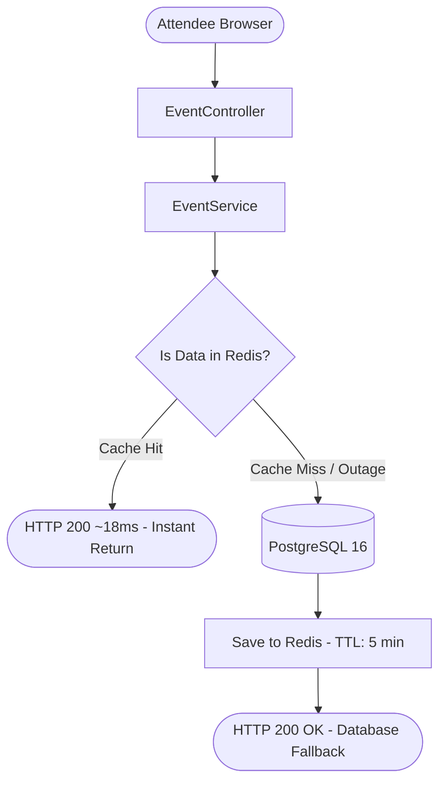
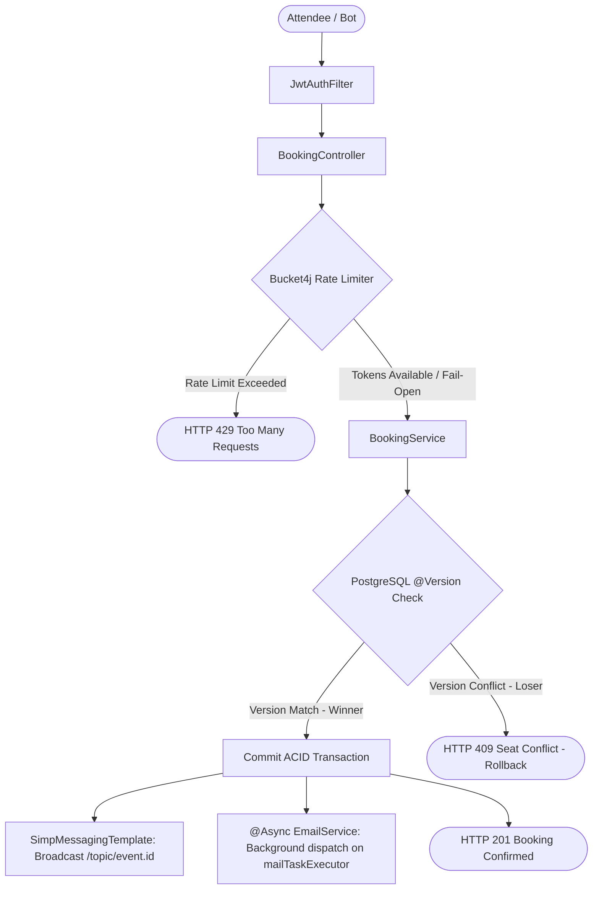
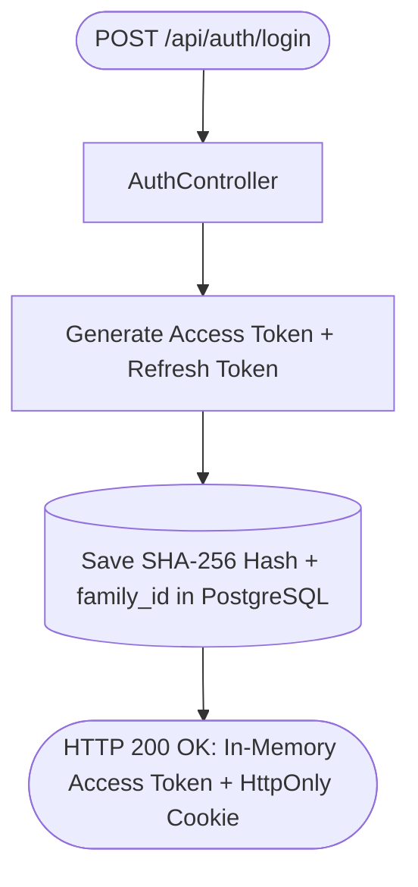
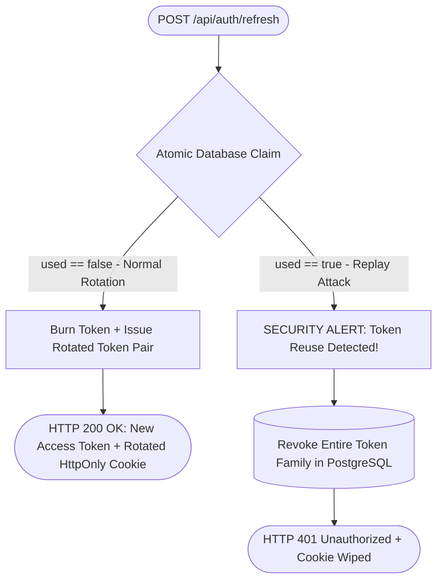

# Master Request Lifecycle & System Pipeline

**Objective:** Trace how requests traverse security, validation, distributed rate limiting, caching, and optimistic locking to final HTTP dispatch.

---

## High-Level Request Pipeline

```
[ Browser / Frontend Client ]
             │
             │ HTTPS (In-Memory Bearer Token + HttpOnly Cookie)
             ▼
[ 1. Spring Security Filter Chain ]
     ├── CorsFilter (Dynamic YAML origin verification via CorsProperties)
     └── JwtAuthFilter (Stateless Bearer JWT validation & UserDetails extraction)
             │
             ▼
[ 2. Web Layer & Validation ]
     ├── DTO Binding & Validation (@Valid Jakarta constraints)
     └── Client IP Extraction (X-Forwarded-For, X-Real-IP, RemoteAddr)
             │
             ▼
[ 3. Anti-Scalping Rate Limiter (Bucket4j + Redis 7) ]
     ├── Per-IP Limit Check (rate:booking:ip:{clientIp})
     ├── Per-User Limit Check (rate:booking:user:{username})
     └── Fail-Open Try/Catch Guard (Bypasses limiter if Redis is unavailable)
             │
             ▼
[ 4. Service Layer ]
     ├── Business Logic Orchestration (@Transactional boundaries)
     └── Ownership & Role Verification (User, Organizer, Admin)
             │
             ▼
[ 5. Distributed Caching Layer (Redis 7) ]
     ├── Cache Lookup (@Cacheable hot paths in Redis)
     │     ├── Cache Hit: Return cached JSON immediately (< 20ms)
     │     ├── Cache Miss: Proceed to database query
     │     └── Cache Error: Fail-open fallback via CacheErrorConfig
     └── Cache Eviction (@CacheEvict purges stale catalog keys on updates)
             │
             ▼
[ 6. Persistence & Concurrency Control (PostgreSQL 16) ]
     ├── Optimistic Locking: Hibernate @Version check on Seat (WHERE id=? AND version=?)
     ├── ACID Commit: Commit booking or trigger atomic batch rollback on collision
     ├── Real-Time Broadcast: SimpMessagingTemplate pushes status to /topic/event.{id}
     └── Async Notification: @Async EmailService dispatches receipt on mailTaskExecutor
             │
             ▼
[ 7. Response Dispatch ]
     ├── HTTP 200 / 201: ApiResponse<T> JSON envelope (unblocked by email dispatch)
     ├── HTTP 409: Seat conflict (ObjectOptimisticLockingFailureException)
     └── HTTP 429: Rate limit exceeded (Retry-After header attached)
```

---

## Workflow 1: Live Event Catalog Read Flow (`GET /api/events`)



* **Cache Key:** `events::all:{category}:{search}`. Hit returns in ~18ms.
* **Fail-Open:** If Redis is down, `CacheErrorConfig` falls back to PostgreSQL (HTTP 200 OK).
* **Eviction:** Mutations trigger `@CacheEvict(value = {"events", "event"}, allEntries = true)`.
* **Deep Dive:** [`distributed-caching.md`](distributed-caching.md).

---

## Workflow 2: Ticket Booking & Concurrency Flow (`POST /api/bookings`)



* **Anti-Scalping:** Bucket4j IP bucket (burst 10) & User bucket (burst 5). Exceeded capacity returns HTTP 429.
* **Fail-Open:** Redis outage or 200ms timeout bypasses limiter to PostgreSQL.
* **Optimistic Locking:** `UPDATE seats SET status='BOOKED', version=2 WHERE id=:id AND version=1`.
  * Winner (1 row affected): HTTP 201 Created.
  * Loser (0 rows affected): OptimisticLockingFailure -> transaction rollback -> HTTP 409 Conflict.
* **Async Decoupling:** `EmailService` dispatches confirmation emails on a background thread pool (`mailTaskExecutor`). Zero impact on HTTP response latency even if SMTP is slow or unreachable.
* **Deep Dives:** [`distributed-rate-limiting.md`](distributed-rate-limiting.md) and [`concurrency-control.md`](concurrency-control.md).

---

## Workflow 3: Dual-Token Authentication & Rotation Flow (`/api/auth/*`)

### Phase 1: Login & Token Issuance


### Phase 2: Silent Rotation & Replay Defense


* **Issuance:** 15-minute access token in memory + 7-day refresh token in HttpOnly cookie.
* **Rotation:** Atomic DB claim prevents simultaneous refresh race conditions.
* **Replay Trap:** Reuse detection revokes entire session family in PostgreSQL via `@Transactional(noRollbackFor = BadCredentialsException.class)`.
* **Deep Dive:** [`security-and-auth.md`](security-and-auth.md).
