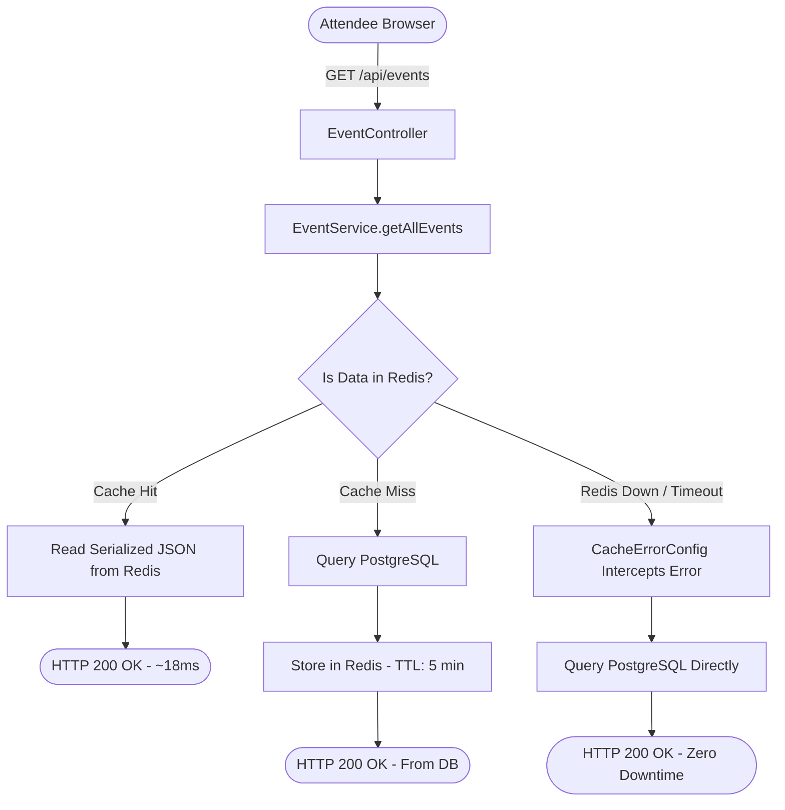
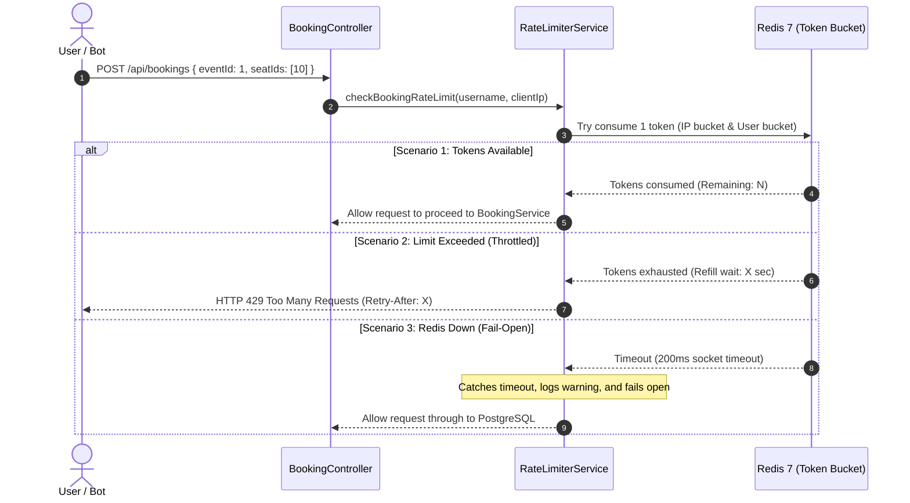
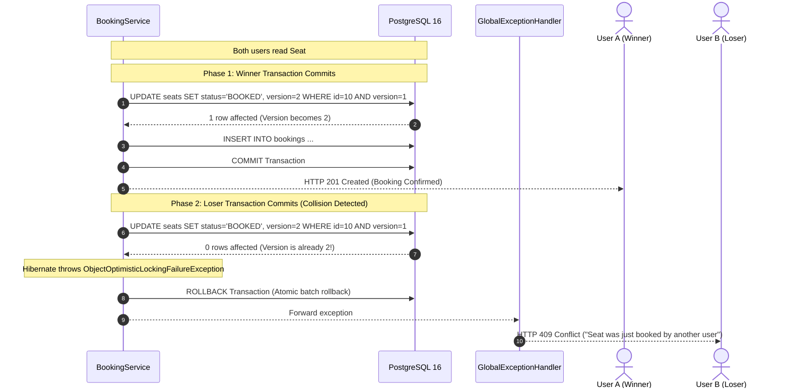
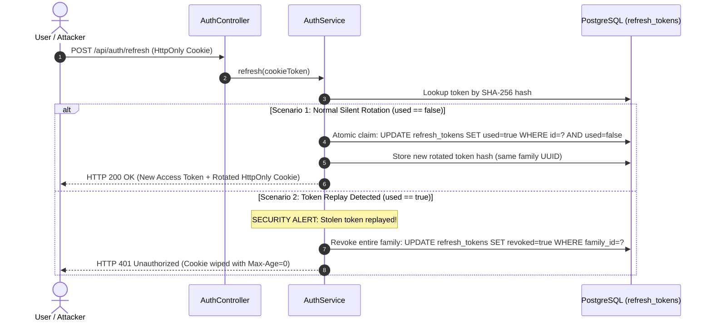

# End-to-End System Architecture & Request Lifecycle

This document provides a clean, visual walkthrough of how I architected QuickTix's primary request workflows across the frontend, security filters, rate limiters, caching layers, business logic, and transactional database persistence.

---

## High-Level Request Pipeline

I structured the platform around clear architectural boundaries so that cross-cutting concerns (security, anti-scalping limits, caching) are handled before requests reach heavy database transactions:

```
[ Browser / Frontend Client ]
             │
             │ HTTPS (In-Memory Bearer Token + HttpOnly Cookie)
             ▼
[ 1. Spring Security Filter Chain ]
     ├── CorsFilter (Dynamic YAML origin verification via CorsProperties)
     └── JwtAuthFilter (Stateless Bearer JWT validation & UserDetails extraction)
             │
             ▼
[ 2. Web Layer & Validation ]
     ├── DTO Binding & Validation (@Valid Jakarta constraints)
     └── Client IP Extraction (X-Forwarded-For, X-Real-IP, RemoteAddr)
             │
             ▼
[ 3. Anti-Scalping Rate Limiter (Bucket4j + Redis 7) ]
     ├── Per-IP Limit Check (rate:booking:ip:{clientIp})
     ├── Per-User Limit Check (rate:booking:user:{username})
     └── Fail-Open Try/Catch Guard (Bypasses limiter if Redis is unavailable)
             │
             ▼
[ 4. Service & Caching Layer ]
     ├── Catalog Reads: Spring Cache (@Cacheable hot paths in Redis)
     │     └── CacheErrorConfig (Falls back to PostgreSQL if Redis times out)
     └── Writes / Bookings: @Transactional boundaries
             │
             ▼
[ 5. Persistence & Concurrency Control ]
     ├── Optimistic Locking: Hibernate @Version check on Seat
     ├── PostgreSQL 16: ACID commit with unique constraints
     └── Cache Invalidation: @CacheEvict purges stale catalog entries
             │
             ▼
[ 6. Response Dispatch ]
     ├── HTTP 200 / 201: ApiResponse<T> JSON envelope
     ├── HTTP 409: Seat conflict (ObjectOptimisticLockingFailureException)
     └── HTTP 429: Rate limit exceeded (Retry-After header attached)
```

---

## Workflow 1: Live Event Catalog & Distributed Caching (`GET /api/events`)

### Purpose
Event browsing accounts for more than 90% of total application traffic. I designed this workflow to serve catalog requests directly from Redis memory in under 20ms while guaranteeing that a Redis outage never causes HTTP 500 errors.

### Visual Architecture



### The 3 Execution Scenarios

1. **Cache Hit (The Fast Path):**
   * The client requests the catalog with optional search or category parameters.
   * `EventService` looks up the composite key `events::all:{category}:{search}` in Redis 7.
   * Redis returns the cached JSON in **~18ms**, completely bypassing PostgreSQL.

2. **Cache Miss (First Request or Expired TTL):**
   * If the key does not exist in Redis, the service queries PostgreSQL.
   * Spring Cache stores the result in Redis with a 5-minute time-to-live (`Duration.ofMinutes(5)`).
   * Returns **HTTP 200 OK** to the client.

3. **Redis Outage (Fail-Open Resilience):**
   * If Redis crashes or experiences network partitions, Spring Cache would normally throw an unhandled `QueryTimeoutException` (HTTP 500).
   * My [`CacheErrorConfig.java`](../server/src/main/java/com/asyncsourav/quicktix/config/CacheErrorConfig.java) intercepts the error, logs a warning, and treats it as a simple cache miss.
   * The application queries PostgreSQL directly, returning **HTTP 200 OK** with zero downtime for attendees.

---

## Workflow 2: Ticket Booking & Concurrency Control (`POST /api/bookings`)

### Purpose
The booking reservation endpoint is the most mission-critical pipeline in QuickTix. It protects the platform against two distinct failure modes:
1. **Edge Abuse:** Automated scalper bots exhausting database connection pool threads with parallel spam.
2. **Database Over-Selling:** Multiple concurrent attendees attempting to book the exact same seat simultaneously.

I designed this workflow as a two-stage pipeline:

---

### Stage A: Anti-Scalping Edge Limiter (Bucket4j + Redis)

Before any database connection is opened, the request must pass through my dual-tier distributed rate limiter:



* **Per-IP Limit:** Capacity 10 tokens, refill 2 tokens/sec (blocks unauthenticated bot clusters).
* **Per-User Limit:** Capacity 5 tokens, refill 1 token/sec (blocks authenticated single-account automation scripts).
* **Fail-Open Design:** If Redis fails, the limiter allows requests through because PostgreSQL optimistic locking guarantees business correctness.

---

### Stage B: Concurrency Control in PostgreSQL (Optimistic Locking)

Once the request clears the rate limiter, [`BookingService.java`](../server/src/main/java/com/asyncsourav/quicktix/service/BookingService.java) executes inside a Spring `@Transactional` boundary.

Here is what happens when **User A (Winner)** and **User B (Loser)** attempt to reserve the same seat (`id = 10, version = 1`) at the exact same millisecond:



* **Why Zero Double-Bookings Occur:** The database update requires `WHERE version = 1`. Because User A's commit incremented the version to `2`, User B's update affects `0` rows.
* **Atomic Batch Safety:** If an attendee reserves multiple seats (e.g. Seats 10, 11, 12) and even one seat experiences a collision, the entire transaction rolls back atomically. Zero partial reservations are ever saved.

---

## Workflow 3: Dual-Token Auth, Silent Rotation & Replay Defense (`/api/auth/*`)

### Purpose
To provide seamless authentication for human users while eliminating XSS credential theft and automatically neutralizing stolen refresh tokens.

### Token Strategy
* **Access Token:** 15-minute lifespan, stored only in frontend memory (never in `localStorage`).
* **Refresh Token:** 7-day lifespan, sent in a Secure, `HttpOnly` cookie inaccessible to JavaScript.
* **Database Session:** SHA-256 token hash tracked in PostgreSQL with a unique `family_id`.

---

### Silent Rotation vs Replay Attack Defense



### Key Engineering Defenses

1. **Atomic Token Claiming:**
   I wrote the claim statement as a single atomic SQL query in [`RefreshTokenRepository.java`](../server/src/main/java/com/asyncsourav/quicktix/repository/RefreshTokenRepository.java):
   ```sql
   UPDATE refresh_tokens SET used = true WHERE id = :id AND used = false AND revoked = false;
   ```
   If two parallel requests hit `/api/auth/refresh` at the same time, only one can update the row. The other receives 0 rows affected and fails instantly, preventing split session families.

2. **Commit on Reuse Detection (`noRollbackFor`):**
   In [`AuthService.java`](../server/src/main/java/com/asyncsourav/quicktix/service/AuthService.java), I configured:
   ```java
   @Transactional(noRollbackFor = BadCredentialsException.class)
   public AuthResponse refresh(String incomingToken, HttpServletResponse response) { ... }
   ```
   This ensures that when token reuse is detected, the family revocation is committed to PostgreSQL before the HTTP 401 exception is thrown, guaranteeing that the stolen session family is permanently terminated.
