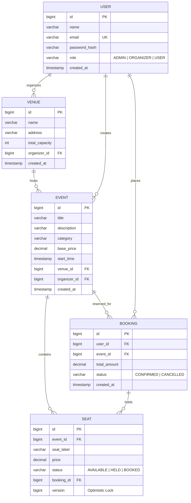

# QuickTix Server

Production-ready REST API service for the QuickTix event ticket booking platform, implemented using [Java 25](https://openjdk.org/projects/jdk/25/) and [Spring Boot 4.0](https://spring.io/projects/spring-boot).

The service handles authentication, venue administration, event publishing, automatic seat inventory generation, and transactional seat bookings with optimistic locking concurrency controls to guarantee that seats can never be double-booked.

<!-- SCREENSHOT: Swagger UI interactive dashboard at http://localhost:8080/swagger-ui.html with Authorize bearer dialog open -->

---

## Architectural Principles

1. **Stateless Security**: Authentication is managed using signed JSON Web Tokens (JJWT HS256) passing in the `Authorization: Bearer <token>` header. No server-side session state is maintained.
2. **Strict Encapsulation**: Domain entities are strictly isolated from the HTTP boundary. Every request and response payload is modeled using immutable Java Records with declarative Jakarta Bean Validation annotations.
3. **Data Integrity & ACID Guarantees**: Bookings operate within atomic `@Transactional` boundaries. If a single seat in a multi-seat reservation fails validation or collides with another user, all changes roll back immediately.
4. **Optimistic Locking**: Rather than locking database rows pessimistically (which degrades throughput and introduces deadlocks), entity version checks detect collisions at commit time.
5. **Unified API Contract**: All controller endpoints return standardized JSON envelopes (`ApiResponse<T>` for success and `ErrorResponse` for failure).

---

## Technology Stack

* **Language:** [Java 25](https://openjdk.org/projects/jdk/25/) (Eclipse Temurin OpenJDK)
* **Build Tool:** [Apache Maven 3.9](https://maven.apache.org/)
* **Framework:** [Spring Boot 4.0.x](https://spring.io/projects/spring-boot)
  * `spring-boot-starter-webmvc`: Embedded Apache Tomcat 11 servlet engine
  * `spring-boot-starter-data-jpa`: [Hibernate ORM 7.2](https://hibernate.org/orm/) persistence engine
  * `spring-boot-starter-security`: Declarative role-based access control and filter pipeline
  * `spring-boot-starter-validation`: Jakarta Bean Validation 3.0
* **Database Engine:** [PostgreSQL 16](https://www.postgresql.org/)
* **Connection Pooling:** [HikariCP 7.0](https://github.com/brettwooldridge/HikariCP)
* **JWT Security:** [JJWT (io.jsonwebtoken) 0.12.6](https://github.com/jwtk/jjwt)
* **API Documentation:** [springdoc-openapi-starter-webmvc-ui 2.8.5](https://springdoc.org/)
* **Boilerplate Reduction:** [Project Lombok 1.18](https://projectlombok.org/)

---

## Domain Model & Entity Relationships



### Entity Specifications

| Entity | Primary Key | Critical Constraints | Concurrency Attribute |
| :--- | :--- | :--- | :--- |
| `User` | `Long id` | `email` is unique and normalized to lowercase | None |
| `Venue` | `Long id` | Foreign key to `User` (Organizer) | None |
| `Event` | `Long id` | Foreign keys to `Venue` and `User` (Organizer) | None |
| `Seat` | `Long id` | Unique index on `(event_id, seat_label)` | `@Version private Long version;` |
| `Booking` | `Long id` | Foreign keys to `User` and `Event` | None |

---

## Concurrency Architecture & Double-Booking Prevention

### The Race Condition Problem
During popular event ticket drops, thousands of users query the same seat map simultaneously. Two concurrent requests reading `status = 'AVAILABLE'` for Seat A3 will both attempt to transition it to `BOOKED`. In an uncoordinated system, both succeed, selling one seat to two customers.

### The Solution: Optimistic Locking with `@Version`
QuickTix avoids row-level read locks (which serialize reads and cause database timeouts) by using optimistic locking:

```java
@Entity
@Table(name = "seats", uniqueConstraints = {
    @UniqueConstraint(name = "uk_event_seat_label", columnNames = {"event_id", "seat_label"})
})
public class Seat {
    // ...
    @Enumerated(EnumType.STRING)
    @Column(nullable = false)
    private SeatStatus status;

    @Version
    @Column(nullable = false)
    private Long version;
}
```

### Execution Pipeline (`BookingService.createBooking`)

1. **Transactional Boundary**: The reservation method is marked `@Transactional`.
2. **Validation**: The service queries `seatRepository.findAllById(request.seatIds())` and verifies that all requested seats belong to the specified event and are in `SeatStatus.AVAILABLE` status.
3. **State Transition**: Each seat is updated to `SeatStatus.BOOKED` and linked to the new `Booking` record.
4. **Database Commit & Version Check**: When the transaction flushes SQL updates, Hibernate automatically appends a version check to the query:
   ```sql
   UPDATE seats 
   SET status = 'BOOKED', booking_id = ?, version = 2 
   WHERE id = 3 AND version = 1;
   ```
5. **Collision Detection**: If another thread committed a state change to Seat 3 milliseconds earlier, the database row's version is already `2`. The `WHERE id = 3 AND version = 1` condition returns zero updated rows.
6. **Automatic Rollback & Exception Translation**: Hibernate throws an `ObjectOptimisticLockingFailureException`. The transaction immediately aborts, discarding any partially reserved seats.
7. **HTTP Translation**: [GlobalExceptionHandler.java](file:///c:/Users/xsour/OneDrive/Desktop/Quick%20Tik%20Booking/server/src/main/java/com/asyncsourav/quicktix/exception/GlobalExceptionHandler.java) catches the exception and returns:

```json
{
  "timestamp": "2026-10-14T16:11:51.123456",
  "status": 409,
  "error": "Conflict",
  "message": "This seat was just selected or booked by another user. Please choose an available seat.",
  "path": "/api/bookings"
}
```

<!-- SCREENSHOT: Node.js race condition script output showing 10 parallel requests with 1 winner (201) and 9 conflict responses (409) -->

---

## Production Multi-Stage Containerization

The backend utilizes an optimized multi-stage [Dockerfile](file:///c:/Users/xsour/OneDrive/Desktop/Quick%20Tik%20Booking/server/Dockerfile):

```dockerfile
# Stage 1: Build stage with full JDK compiler and cached Maven dependencies
FROM maven:3.9-eclipse-temurin-25-alpine AS build
WORKDIR /app

# Cache dependencies layer
COPY pom.xml .
RUN mvn dependency:go-offline

# Copy source and package JAR
COPY src ./src
RUN mvn clean package -DskipTests  

# Stage 2: Minimal runtime image containing JRE only
FROM eclipse-temurin:25-jre-alpine
WORKDIR /app
COPY --from=build /app/target/*.jar app.jar
EXPOSE 8080
ENTRYPOINT ["java", "-jar", "app.jar"]
```

### Docker Image Benchmark Results
Measurements captured via `docker images quicktix`:

```text
IMAGE             ID             DISK USAGE   CONTENT SIZE
quicktix:multi    24ed2f910a58        434MB          137MB        
quicktix:single   9478ced84cff        870MB          310MB        
```

* **Disk Usage Reduction:** **50.11%** (from 870 MB to 434 MB)
* **Content Size Reduction:** **55.81%** (from 310 MB to 137 MB)
* **Security Hardening:** The final runtime image contains zero build tools (no Maven, no `javac`), zero cached source files, and zero temporary build artifacts.

---

## Quick Start

### 1. Run via Docker Compose (Recommended)
From the repository root folder:

```bash
docker compose up -d --build
```

This single command starts:
* `quicktix-postgres` on port `5432` with a persistent named volume and healthcheck.
* `quicktix-backend` on port `8080` after the database healthcheck passes.
* Automatic data seeding (3 users, 3 venues, 4 events, 120+ seats, 1 sample booking).

To monitor backend startup logs:
```bash
docker logs -f quicktix-backend
```

To verify container health:
```bash
docker compose ps
```

To stop the containers while preserving database state:
```bash
docker compose down
```

### 2. Run Locally in IDE (Development Mode)
If actively developing in IntelliJ IDEA or VS Code:

1. Start only the PostgreSQL database container:
   ```bash
   docker compose up -d postgres
   ```
2. Run the application from your IDE or via the Maven wrapper:
   ```bash
   cd server
   ./mvnw spring-boot:run
   ```

---

## Configuration Reference

Settings are externalized via environment variables and configured across `application.yml`, `application-dev.yml`, and `application-prod.yml`:

| Environment Variable | Description | Development Default | Production Default |
| :--- | :--- | :--- | :--- |
| `DB_URL` | PostgreSQL JDBC URL | `jdbc:postgresql://localhost:5432/quicktix_db?options=-c%20timezone%3DUTC` | `jdbc:postgresql://postgres:5432/quicktix_db?options=-c%20timezone%3DUTC` |
| `DB_USERNAME` | Database username | `postgres` | `${DB_USERNAME}` |
| `DB_PASSWORD` | Database password | `postgres` | `${DB_PASSWORD}` |
| `JWT_SECRET` | 256-bit HS256 signature key | `404E635266556A586E3272357538782F413F4428472B4B6250645367566B5970` | `${JWT_SECRET}` |
| `JWT_EXPIRATION_MS` | Access token time-to-live | `86400000` (24 Hours) | `86400000` |
| `PORT` | HTTP server port | `8080` | `8080` |
| `SPRING_PROFILES_ACTIVE` | Active configuration profile | `dev` | `prod` |

---

## REST API Specification

### Response Contracts

#### Success Envelope (`ApiResponse<T>`)
```json
{
  "success": true,
  "message": "Booking confirmed successfully",
  "data": {
    "id": 1,
    "userId": 3,
    "userName": "Sourav (Attendee)",
    "eventId": 1,
    "eventTitle": "Coldplay: Music of the Spheres World Tour",
    "seats": [
      {
        "id": 3,
        "eventId": 1,
        "seatLabel": "A3",
        "price": 89.99,
        "status": "BOOKED"
      }
    ],
    "totalAmount": 89.99,
    "status": "CONFIRMED",
    "createdAt": "2026-10-14T16:11:52.124"
  },
  "timestamp": "2026-10-14T16:11:52.125"
}
```

#### Error Envelope (`ErrorResponse`)
```json
{
  "timestamp": "2026-10-14T16:11:52.412",
  "status": 409,
  "error": "Conflict",
  "message": "This seat was just selected or booked by another user. Please choose an available seat.",
  "path": "/api/bookings"
}
```

### Complete Endpoint Registry (22 Endpoints)

| Group | Method | Path | Required Role | Summary |
| :--- | :---: | :--- | :---: | :--- |
| **Auth** | `POST` | `/api/auth/register` | Public | Register new user account |
| | `POST` | `/api/auth/login` | Public | Authenticate user and issue JWT |
| **Events** | `GET` | `/api/events` | Public | List events with category & search filters |
| | `GET` | `/api/events/{id}` | Public | Get event details by ID |
| | `GET` | `/api/events/{id}/seats` | Public | Get seat map and availability |
| | `POST` | `/api/events` | `ORGANIZER`, `ADMIN` | Create event and generate seats |
| | `PUT` | `/api/events/{id}` | `ORGANIZER`, `ADMIN` | Update event details (ownership verified) |
| | `DELETE` | `/api/events/{id}` | `ORGANIZER`, `ADMIN` | Delete event (ownership verified) |
| **Venues** | `GET` | `/api/venues` | Public | List all venues |
| | `GET` | `/api/venues/{id}` | Public | Get venue details by ID |
| | `GET` | `/api/venues/organizer/{id}` | Public | List venues by organizer ID |
| | `POST` | `/api/venues` | `ORGANIZER`, `ADMIN` | Create new venue |
| | `PUT` | `/api/venues/{id}` | `ORGANIZER`, `ADMIN` | Update venue (ownership verified) |
| | `DELETE` | `/api/venues/{id}` | `ORGANIZER`, `ADMIN` | Delete venue (ownership verified) |
| **Bookings**| `POST` | `/api/bookings` | Authenticated | Create booking with optimistic locking |
| | `GET` | `/api/bookings/me` | Authenticated | Get current user's bookings |
| | `GET` | `/api/bookings/{id}` | Authenticated | Get booking details (ownership verified) |
| | `DELETE` | `/api/bookings/{id}` | Authenticated | Cancel booking and release seats |
| **Admin** | `GET` | `/api/admin/users` | `ADMIN` | List all registered users |
| | `GET` | `/api/admin/stats` | `ADMIN` | Platform aggregate revenue & booking statistics |
| | `GET` | `/api/admin/bookings` | `ADMIN` | Platform-wide booking audit ledger |
| **Health** | `GET` | `/api/ping` | Public | Healthcheck and service liveness probe |

---

## Interactive Documentation (Swagger UI)

With the server running, access the interactive OpenAPI documentation:

* **Swagger UI:** [http://localhost:8080/swagger-ui.html](http://localhost:8080/swagger-ui.html)
* **OpenAPI 3.0 JSON:** [http://localhost:8080/v3/api-docs](http://localhost:8080/v3/api-docs)

To test authenticated endpoints in Swagger UI:
1. Call `POST /api/auth/login` with demo credentials (`user@quicktix.com` / `password123`).
2. Copy the `data.token` string from the response.
3. Click the **Authorize** lock button in the top right of the Swagger UI interface.
4. Paste the token into the value field and click **Authorize**.

---

## Author

**Sourav Kumar**
* **GitHub:** [https://github.com/asyncsourav](https://github.com/asyncsourav)
* **LinkedIn:** [https://www.linkedin.com/in/asyncsourav](https://www.linkedin.com/in/asyncsourav)
* **LeetCode:** [https://leetcode.com/u/asyncsourav](https://leetcode.com/u/asyncsourav)
* **Email:** [xsouravkumar357@gmail.com](mailto:xsouravkumar357@gmail.com)
